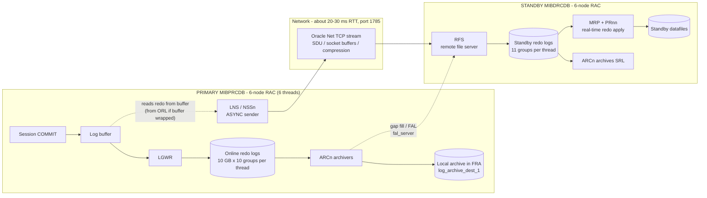
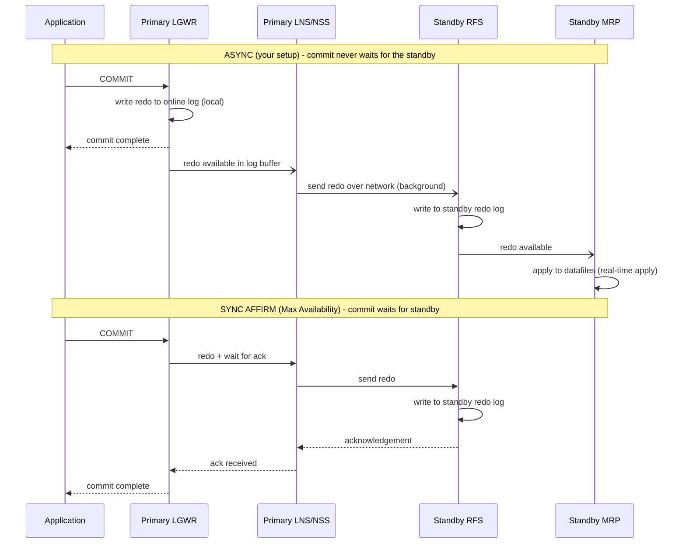
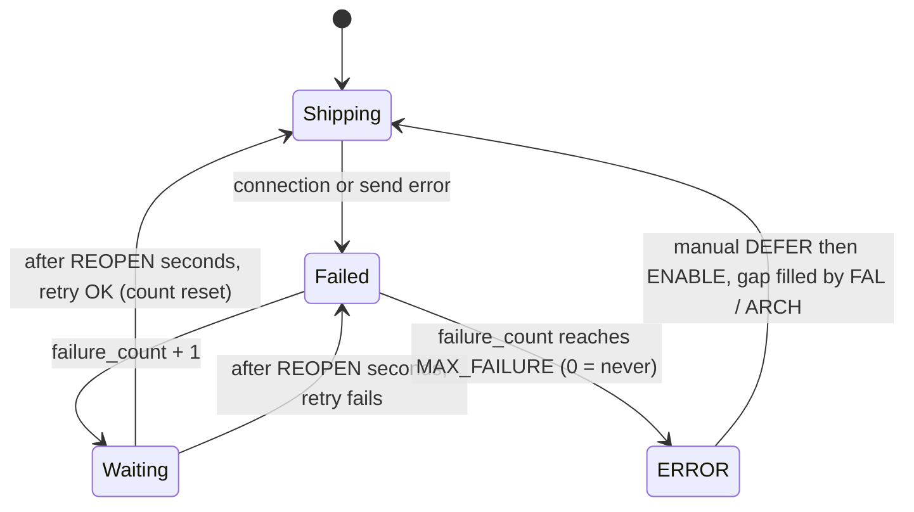

# Oracle Data Guard – Configuration, Network Tuning, Lag Troubleshooting, Switchover & Failover

Source of truth for the "as-is" section: `dataguard_configuration.txt` in this repo.
Items marked **[VERIFY]** are not in that file and must be confirmed on the actual systems before the runbook is used.
Values marked *(verified 2026-11-27)* were read from the primary (`MIBPRCDB`) via SQL*Plus. Standby (`MIBDRCDB`) values were verified the same day; DG process list and backhaul listener added 2026-11-28.

**Contents:** 1 Current configuration · 2 Network parameters · 3 Lag troubleshooting · 4 Switchover vs failover · 5 Switchover runbook · 6 Failover runbook · 7 Pitfalls · 8 Quick queries · **9 Types of Data Guard** · **10 Redo transport attributes (REOPEN, MAX_FAILURE, …) and tuning**

---

## 1. Current configuration (as-is)

### 1.1 Topology

| Item | Value (from file) |
|---|---|
| Primary `db_unique_name` | `MIBPRCDB` |
| Physical standby (DR) | `MIBDRCDB` (dest 2) |
| Other DG_CONFIG members | `eisdcbkp` (dest 3, remote backup/standby via SCAN), `GGINTMIN` (dest 4), `GGDRDB` (dest 5) – the GG* entries are GoldenGate foreign-archive targets, not standbys |
| Primary RAC | **6 instances / 6 redo threads** (v$log shows threads 1-6) |
| Transport mode | **ASYNC** to MIBDRCDB, no compression, `AFFIRM NO` |
| Protection mode | **MAXIMUM PERFORMANCE** *(verified on standby, all 6 instances)* |
| Oracle version | 19c (19.0.0.0, `/u01/app/oracle/product/19.0.0.0/dbhome_1`) *(from tnsping banner on the standby)* – the 12.2+ commands in §5/§6 are available |
| Standby | 6-instance RAC (`gv$database` returns 6 rows for `MIBDRCDB`) |
| Broker | `dg_broker_start=FALSE` *(verified)* – no broker, all role changes are manual SQL |

```
 MIBPRCDB (6-node RAC)
   |-- dest_1  local FRA (all_logfiles, all_roles)
   |-- dest_2  ASYNC --> MIBDRCDB            ENABLED   <- the real DR standby
   |-- dest_3  ASYNC --> eisdcbkp (SCAN:1786) DEFERRED
   |-- dest_4  ASYNC/ARCH --> GG_DB (GGINTMIN) ENABLED  (GoldenGate archive feed)
   '-- dest_5  ASYNC/ARCH --> GGDRDB           DEFERRED
```

### 1.2 Key parameters

| Parameter | Value | Meaning / comment |
|---|---|---|
| `log_archive_config` | `DG_CONFIG=(MIBDRCDB,MIBPRCDB,eisdcbkp,GGINTMIN,GGDRDB)` | Every db_unique_name that may send/receive redo. A new standby must be added here on **all** members. |
| `log_archive_dest_1` | `location=USE_DB_RECOVERY_FILE_DEST valid_for=(all_logfiles,all_roles) db_unique_name=MIBPRCDB` | Local archiving. Good: valid in every role. |
| `log_archive_dest_2` | `service=MIBDRCDB async valid_for=(online_logfiles,primary_role) net_timeout=30 reopen=60 max_failure=10 db_unique_name=MIBDRCDB` | Redo transport to DR. See notes below. |
| `log_archive_dest_state_2` | ENABLE | |
| `log_archive_dest_3` | `SERVICE=eisdczdingest-scan1:1786/eisdcbkp:dedicated ASYNC VALID_FOR=(ALL_LOGFILES,ALL_ROLES) DB_UNIQUE_NAME=eisdcbkp` | `:dedicated` forces a dedicated server connection. **State = DEFER** – not shipping right now. |
| `log_archive_dest_4` / `_5` | `SERVICE=GG_DB / GGDRDB ASYNC NOREGISTER ARCH MAX_CONNECTIONS=3 ... TEMPLATE=/gg_foreign_archives/...` | GoldenGate downstream archive copies. dest_4 ENABLED, dest_5 DEFERRED. Not DG standbys. |
| `archive_lag_target` | 900 | Forces a log switch on every thread at least every 15 min. |
| `log_archive_max_processes` | 16 | Archiver (ARCn) processes; also used for gap resolution. |
| `log_archive_min_succeed_dest` | 1 | Only local dest_1 must succeed for a log to be reusable (normal for ASYNC). |
| `log_archive_format` | `%t_%s_%r.arc` | |

Dest 2 attribute notes:

* `ASYNC` – LGWR ships redo from the log buffer without waiting for the standby (no commit-time impact from network latency, but potential data loss on failover = current lag).
* `valid_for=(online_logfiles,primary_role)` – only ships **current redo while this DB is primary**. After a switchover this destination is inert on the new standby; that is correct, but the **new primary must have its own dest pointing back to the old primary** (see §5, step "prepare new primary").
* `reopen=60 max_failure=10` – after a failed connection, retry every 60 s, and **give up after 10 consecutive failures**. After that the destination goes to ERROR/"closed" and will not retry until you re-enable it (`alter system set log_archive_dest_state_2=defer; ... =enable;`). This is a classic cause of "lag keeps growing and nobody noticed" after a network outage > 10 min. Consider `max_failure=0` (retry forever) and monitor instead.
* `net_timeout=30` – effective for SYNC; with ASYNC it has little practical effect. Keep or remove, but don't rely on it for ASYNC.
* No `compression` – `COMPRESSION=DISABLE` in `gv$archive_dest`. Compression needs the Advanced Compression option (licence).

### 1.3 Redo logs

| | Primary online redo (v$log) | Standby redo (v$standby_log) |
|---|---|---|
| Size | ~10 GB (1.0737E+10 bytes) | ~10 GB |
| Block size | 512 | 512 |
| Members | 2 per group | – |
| Groups | 60 = **10 per thread × 6 threads** | 66 = **11 per thread × 6 threads** |

Standby redo rule: **(online groups per thread + 1) × threads** – 66 = (10+1)×6. ✔ Correct, and the sizes match the online logs, as required. Because the primary can become a standby after switchover, these SRLs must exist on **both** databases. The listing shows them `UNASSIGNED` on the primary, which is expected (SRLs are only used when it is a standby).

**Observation:** 10 GB logs mean a log switch only every few minutes on a busy thread but every 15 min (archive_lag_target) on a quiet one. ASYNC transport ships redo continuously from the log buffer, so large logs do not by themselves delay the standby; they do make archive-based gap fills (a 10 GB file per sequence) slow.

### 1.4 Additional parameters (verified on primary 2026-11-27)

| Parameter | Value | Assessment |
|---|---|---|
| `db_unique_name` | `MIBPRCDB` | ✔ |
| `fal_server` | `MIBDRCDB` | ✔ Already points at the standby. Meaning: when this DB is a *standby*, it fetches missing logs from MIBDRCDB. So the switchover "pre-flip" is already done on this side. |
| `fal_client` | `MIBPRCDB` | Obsolete since 12c (ignored); harmless. |
| `standby_file_management` | `AUTO` | ✔ New datafiles on primary are created on the standby automatically. |
| `db_file_name_convert`, `log_file_name_convert`, `pdb_file_name_convert` | *(empty)* | ✔ OK when both sites use OMF/ASM (+DATA / +RECO). If paths differ, they must be set. |
| `dg_broker_start` | `FALSE` | Manual switchover/failover. No Fast-Start Failover possible without the broker. |
| `db_lost_write_protect` | `TYPICAL` | ✔ Standby detects lost writes on the primary. |
| `db_block_checking` | `FALSE` | ⚠ Oracle recommends `MEDIUM`/`FULL` on the **standby** (cheap there, catches in-memory corruption before it is applied); on the primary it costs CPU – test first. |
| `db_flashback_retention_target` | `1440` (min = 24 h) | Set, but ineffective because flashback is off. |
| `flashback_on` | **`NO`** | ❌ See below. |
| `force_logging` | `YES` | ✔ No NOLOGGING holes on the standby. |

**Action needed – flashback is off on the primary.** Consequences:

* After a **failover** the old primary cannot be reinstated with `FLASHBACK DATABASE`; it must be rebuilt from RMAN (hours for a large DB).
* A **snapshot standby** (§9.3) needs flashback on the standby.
* A guaranteed restore point (§5.1) still works without flashback being on, but it keeps all flashback logs from that point and consumes FRA space.

Recommended: enable on both sites, size the FRA for 24 h of flashback logs (roughly ≈ redo generated per day + changed blocks):

```sql
select flashback_on from v$database;
show parameter db_recovery_file_dest_size
select * from v$recovery_file_dest;
alter database flashback on;     -- online since 11gR2; on the standby, stop MRP first on versions < 18c
```

**Standby side (`MIBDRCDB`) – verified 2026-11-27:**

| Parameter | Value | Assessment |
|---|---|---|
| `fal_server` | `MIBPRCDB` | ✔ Mirror image of the primary |
| `fal_client` | `MIBDRCDB` | ✔ (obsolete in 12c+, harmless) |
| `protection_mode` | MAXIMUM PERFORMANCE | ✔ Matches the primary (ASYNC) |
| `db_block_checking` | `MEDIUM` | ✔ Matches the Oracle recommendation for a standby (the primary is `FALSE`, which is acceptable to avoid CPU cost) |
| `standby_file_management` | `AUTO` | ✔ |
| `log_archive_config` | `DG_CONFIG=(MIBDRCDB,MIBPRCDB,eisdcbkp,GGINTMIN,GGDRDB)` | ✔ Identical to the primary |
| `log_archive_dest_2` | **empty** | ❌ **Reverse-direction destination not configured.** After a switchover the new primary (`MIBDRCDB`) would not ship redo to `MIBPRCDB`. Pre-configure it (deferred) as in §5.1 before any switchover. |
| `standby_db_preserve_states` / `enabled_PDBs_on_standby` | `NONE` / `*` | Sessions are not preserved across a role change; all PDBs are replicated. |
| `flashback_on` | **`NO`** | ❌ Off on **both** sites – see the action in the section above. After a failover or switchover-with-problems neither side can be reinstated by flashback. |

Both sides are therefore already "pre-flipped" for a switchover as far as `fal_server` is concerned.

**Action before the first switchover:** on `MIBDRCDB` set `log_archive_dest_2` to ship to `MIBPRCDB` with `log_archive_dest_state_2=DEFER` (§5.1), and decide which of `dest_3/4/5` (eisdcbkp, GoldenGate feeds) must also exist there (§5.6).

Still to check on the standby **[VERIFY]**: `log_archive_dest_3/4/5`, SRL and online log counts and sizes (`v$standby_log`, `v$log`).

### 1.5 Scripts in the config file / repo

| Script | Purpose |
|---|---|
| `er.sql <dest_id>` | Shows `gv$archive_dest` row per instance for one destination: error, status, last log sequence shipped, valid_type, remote template. Run `@er 2` first when lag is reported. |
| `missing_log.sql`, `role.sql` (repo) | Gap check / role check – see the files. |

Reading the `@er 2` output in the file: all 6 instances show `STATUS=VALID`, empty ERROR, and `LOG_SEQUENCE` equal to each thread's current online log (269123, 270827, 240591, 237713, 218223, 209205 = the CURRENT groups in v$log). That means redo was being shipped to the DR in real time, with no destination errors at the time of capture. The `@er 4` output shows `LOG_SEQUENCE 0` for GG – GoldenGate is receiving files via the ARCH template rather than a sequence counter, which is normal for that feed.

### 1.6 Data Guard processes on the standby (`gv$dataguard_process`, captured 2026-11-28)

278 rows over the 6 standby instances. Per instance: `LGWR`, `TMON` (redo transport monitor), `TT00` (gap manager), `TT01` (transport timer), `ARC0`–`ARCf` (16 archivers = `log_archive_max_processes`), and RFS processes. Only **instance 6** also runs `MRP0` + the parallel recovery set `PR00`–`PR1C` (1 log merger + 48 apply slaves).

| Observation | Reading |
|---|---|
| One `RFS async` (`async ORL multi`) per primary thread, spread over **all 6 standby instances** (threads 1, 3, 4, 5, 6, 2 on different nodes) | ✔ Real-time transport into standby redo logs; every primary thread has its own stream and they are not funnelled through one standby node. States are `RECEIVING`/`WRITING`/`IDLE` = actively receiving or between redo bursts. |
| `RFS async` sequence per thread (269317, 271018, 240782, 237904, 218413, 209396) | Slightly ahead of the `@er 2` values from the day before (269123, 270827, 240591, 237713, 218223, 209205) – same threads, moving forward consistently. |
| `MRP0` on instance 6, `PR00` merging **thread 6 seq 209396** = the same sequence `RFS async` is writing for thread 6 | ✔ Apply is at the tip of the redo stream (real-time apply, no apply lag visible at capture time). Check `v$dataguard_stats` to confirm over time. |
| `RFS archive` / `archive gap` rows, `IDLE`, some with a sequence (e.g. thread 3 seq 240162, thread 6 seq 208884) | Idle ARCH-type connections left from earlier gap/archive shipping. Not an active gap. A gap would show a non-idle row or `gv$archive_gap` rows. |
| `RFS ping` / `TT00 gap manager` present | ✔ Gap detection works in both directions. |
| Apply on a single instance (6) | Normal for RAC standby (only one instance applies). It means instance 6 carries all apply CPU/IO – plan which node applies after a switchover, and keep `MRP` restartable on another node if instance 6 goes down. |

Queries to repeat this check:

```sql
select inst_id, name, role, action, client_role, thread#, sequence#
from gv$dataguard_process order by inst_id, name;

select name, value, time_computed from v$dataguard_stats
where name in ('transport lag','apply lag','apply finish time');
```

### 1.7 Backhaul listener for the standby (from `dataguard_configuration.txt`, node 1)

```
LISTENER_MIIB-BKL =
  (DESCRIPTION_LIST = (DESCRIPTION =
      (SEND_BUF_SIZE=78643200) (RECV_BUF_SIZE=78643200)
      (ADDRESS = (PROTOCOL = TCP)(HOST = 10.177.3.221)(PORT = 1785))))
SID_LIST_LISTENER_MIIB-BKL =
  (SID_LIST = (SID_DESC = (GLOBAL_DBNAME = MIBDRCDB)
      (ORACLE_HOME = /u01/app/oracle/product/19.0.0.0/dbhome_1)
      (SID_NAME = MIBDRCDB1)))
```

Same layout on all nodes (own backhaul IP and `SID_NAME` per node). Review:

| Item | Assessment |
|---|---|
| Dedicated listener on a separate backhaul IP, port **1785** | ✔ Keeps redo traffic off the public/SCAN listeners. Port matches the `MIBPRCDB` alias seen in §2.5. |
| `SEND_BUF_SIZE`/`RECV_BUF_SIZE` = 78,643,200 (75 MB) | ✔ Addresses the BDP issue in §2.1/2.5 (far above 37.5 MB for 10 Gbit @ 30 ms). ⚠ The OS will silently cap it at `net.core.rmem_max`/`wmem_max` – check they are ≥ this value (§2.3), or the setting has no effect. |
| **No `SDU`** on the listener | Add `(SDU=65535)` to the DESCRIPTION and in the primary-side TNS alias used by `dest_2` so both ends agree (§2.2). |
| **Static registration only** (`GLOBAL_DBNAME=MIBDRCDB`, fixed `SID_NAME`) | ✔ Lets you reach the standby while it is in NOMOUNT/MOUNT (restart, RMAN duplicate, rebuild). ⚠ The service is advertised as up even if the instance is down, so a failed instance shows as `ORA-12528/12505`-style errors rather than being removed from the list. |
| Not role-aware | After a switchover the same listener must serve `MIBPRCDB` too (or `MIBPRCDB`'s own backhaul listener must exist). **[VERIFY]** the primary side has the mirror listener (`GLOBAL_DBNAME=MIBPRCDB`, `SID_NAME=MIBPRCDB1..6`) and that `dest_2` on the standby (to be created, §5.1) points to it. |
| Subnet | Backhaul is `10.177.3.x`, while the standby's `MIBPRCDB` alias uses `10.191.210.121–126` (§2.5). **[VERIFY]** which network each direction really uses – ping/tnsping the backhaul IPs and confirm the primary's `MIBDRCDB` alias (`dest_2` service) points to `10.177.3.x`. |
| `ORACLE_HOME` | Listener runs from a DB home, not the Grid home – OK, but confirm it is the same listener binary that `srvctl`/CRS manages (otherwise CRS will not restart it after a node reboot). **[VERIFY]** `lsnrctl status LISTENER_MIIB-BKL` and `crsctl stat res -t`. |

---

## 2. Network parameters

Redo transport is a long-lived TCP stream per instance (LGWR/NSS → RFS on the standby), so throughput is limited by **bandwidth-delay product (BDP)** and TCP window sizing, not just by link speed.

### 2.1 Size the pipe first

```
Redo rate (MB/s)   = from AWR "Redo size per second" at peak, or:
  select thread#, round(sum(blocks*block_size)/1024/1024) mb, count(*)
  from v$archived_log where first_time > sysdate-1 group by thread#;
BDP (bytes)        = bandwidth (bytes/s) × RTT (s)
Required bandwidth ≥ peak redo rate × 1.3 (headroom for catch-up)
```

Measure RTT: `ping -c 20 <standby-host>` or `tnsping MIBDRCDB`. A 1 Gbit/s link with 40 ms RTT has BDP ≈ 5 MB; default buffers (128 KB–few MB) will cap throughput far below link speed.

### 2.2 Oracle Net – `sqlnet.ora` (both primary and standby, in the Grid/DB home used by the listener & instances)

```
# Session data unit – larger = fewer, bigger packets for redo
DEFAULT_SDU_SIZE = 65535      # 12.2+ allows up to 2097152 (2 MB); test before raising
# Socket buffers – set to ~3 × BDP (must be ≤ OS rmem_max/wmem_max, see 2.3)
SEND_BUF_SIZE = 10485760
RECV_BUF_SIZE = 10485760
# Detect dead peers (important for DG so RFS/NSS don't hang for hours)
SQLNET.EXPIRE_TIME = 10       # minutes
TCP.NODELAY = YES             # default; leave on
```

Also set the SDU/buffers on the **TNS alias** and **listener** for the DR service so both ends negotiate it:

```
MIBDRCDB =
  (DESCRIPTION =
    (SDU = 65535)
    (SEND_BUF_SIZE = 10485760)(RECV_BUF_SIZE = 10485760)
    (ADDRESS = (PROTOCOL = TCP)(HOST = <dr-scan>)(PORT = 1521))
    (CONNECT_DATA = (SERVICE_NAME = MIBDRCDB)))

# listener.ora – same SDU / buffer attributes on the listening address / DESCRIPTION
```

(`dest_3` already uses an easy-connect string with a dedicated server; if it is ever re-enabled, note that SDU/buffer sizes cannot be set in easy connect – use a tnsnames alias.)

### 2.3 OS TCP settings (Linux, both sites – values are starting points)

```
# /etc/sysctl.d/99-dataguard.conf
net.core.rmem_max = 16777216
net.core.wmem_max = 16777216
net.ipv4.tcp_rmem = 4096 87380 16777216
net.ipv4.tcp_wmem = 4096 65536 16777216
net.ipv4.tcp_window_scaling = 1
net.ipv4.tcp_sack = 1
net.ipv4.tcp_timestamps = 1
net.core.netdev_max_backlog = 30000
```

`sysctl -p /etc/sysctl.d/99-dataguard.conf`; **restart the redo-shipping sessions** (defer/enable the dest) for new sockets to pick up buffers.

Other network items:

* **MTU / jumbo frames** – use the same MTU end-to-end; mismatched MTU + blocked ICMP causes silent fragmentation stalls. Test: `ping -M do -s 8972 <host>` (jumbo) / `-s 1472` (standard).
* **Firewalls / WAN accelerators** – must not do SSL or Oracle Net "inspection" (SQL*Net ALG); stateful firewalls with short idle timeouts drop idle redo connections → use `SQLNET.EXPIRE_TIME` below the firewall idle timeout.
* **Ports** – listener port(s) on both sides open both directions (needed after switchover). Include the SCAN port for RAC.
* **Redo compression** (`COMPRESSION=ENABLE` on the dest) – use when bandwidth-bound and CPU is available; requires Advanced Compression licence.
* **Redo transport encryption / TLS** – see `tls_in_prod.txt` in this repo if the DR link is TLS.
* **Multiple RAC instances** – each primary instance opens its own stream, so aggregate throughput is the sum; make sure the DR SCAN/listener is not funnelling everything to one node. Specific `SERVICE`/`SERVER=DEDICATED` entries are fine.

### 2.4 Verify

```sql
-- Transport destination health, every instance
select inst_id, dest_id, status, error, gap_status, archived_seq#, applied_seq#
from gv$archive_dest_status where dest_id=2;

-- Network round-trip as seen by Oracle for ASYNC (12c+)
select * from v$redo_dest_resp_histogram where dest_id=2;
```

### 2.5 Observed network data (from the standby, `tnsping MIBPRCDB 10`, 2026-11-27)

* Round trip: **20–30 ms** per tnsping (9 × 30 ms, 1 × 20 ms). tnsping includes listener hand-off time, so the true IP round-trip is a little lower; confirm with `ping -c 20 10.191.210.121`.
* The `MIBPRCDB` alias on the standby lists **6 addresses** `10.191.210.121 … .126`, port **1785**, `SERVER=DEDICATED`, service `MIBPRCDB`. It sets **no SDU or buffer sizes**.
* BDP at 30 ms: 1 Gbit/s ≈ **3.75 MB**, 10 Gbit/s ≈ **37.5 MB**. Linux default socket buffers (often ≤ 4–6 MB, autotuned) can cap a single stream below the link speed on a 30 ms path, so the `SEND_BUF_SIZE`/`RECV_BUF_SIZE` and `sysctl` settings in §2.2–2.3 are worth applying, sized to the real link speed.
* With several primary instances each opening their own stream, aggregate throughput is the sum of the streams (6 instances ⇒ 6 streams).
* Repeat the check the other direction (primary → `MIBDRCDB`): the same alias must exist and work on the primary side because the same set of addresses is needed after a switchover.
* If the 6 addresses are node VIPs (not SCAN), the first reachable address in the list is used each time (no `LOAD_BALANCE` set); that is fine for fail-over but not for spreading load.

---

## 3. Lag – tuning and troubleshooting

### 3.1 Two kinds of lag – find which one first

On the **standby**:

```sql
col name for a25
select name, value, unit, time_computed from v$dataguard_stats
where name in ('transport lag','apply lag','apply finish time','estimated startup time');
```

| Symptom | Meaning | Look at |
|---|---|---|
| **transport lag** high | Redo has not arrived at the standby | primary → network, dest errors, LGWR/NSS, bandwidth |
| **apply lag** high, transport ≈ 0 | Redo is there but not applied | MRP, standby I/O, parallelism, long-running recovery, redo apply stuck |
| Both high | Often transport first, then apply catching up; check transport first | |

Always check per **thread** (6 threads) – one stuck instance's stream can hide behind healthy ones:

```sql
-- primary
select thread#, max(sequence#) from v$archived_log where dest_id=1 group by thread#;
-- standby
select thread#, max(sequence#) from v$archived_log where applied='YES' group by thread#;
select thread#, max(sequence#) received from v$archived_log group by thread#;
```

### 3.2 Transport lag checklist (primary side)

1. `@er 2` (script in this repo) – any ERROR text? STATUS other than VALID?
   * `ORA-12541/12514/12170/12535` → listener/TNS/firewall/network.
   * `ORA-16086` standby has no SRL / SRL too small. `ORA-16191/1017` → password-file/ SYS password mismatch between sites (redo transport uses the password file).
   * Destination `ERROR` with `max_failure` exhausted → re-enable:
     ```sql
     alter system set log_archive_dest_state_2=defer  scope=memory;
     alter system set log_archive_dest_state_2=enable scope=memory;
     ```
2. `select * from v$archive_gap;` on standby – a gap. Fix by letting FAL fetch it (`fal_server`), or copy the missing archive log and `alter database register logfile '<file>';`.
3. Primary alert log + `dest_2` `NSS`/`LNS`/`TTnn` trace for messages about slow network / "LGWR: ASYNC … timeout".
4. Network: throughput test with `iperf3` between hosts; compare to peak redo rate (§2.1). `netstat -s | grep -i retrans`, `ss -ti dst <standby-ip>` (look at `cwnd`, `rtt`, `retrans`).
5. Redo generation spikes: batch jobs, index rebuilds, `NOLOGGING`, huge loads → check AWR / `v$sysstat 'redo size'`; the pipe may simply be smaller than the peak.
6. Log buffer pressure on primary: waits `log file parallel write`, `LGWR wait for redo copy`; archiving stuck (`log_archive_max_processes`, FRA full). Check `select * from v$recovery_file_dest;`.
7. Reduce load: enable redo **compression**, increase SDU/socket buffers (§2), or run catch-up via archived logs (ARCH) in parallel (already 16 ARCn).

### 3.3 Apply lag checklist (standby side)

```sql
-- Is MRP running, what is it doing?
select process, status, thread#, sequence#, block#, blocks from v$managed_standby order by process;
-- Apply rate
select * from v$recovery_progress where item in ('Active Apply Rate','Average Apply Rate','Redo Applied','Last Applied Redo','Active Time');
-- Parallel recovery servers
select * from v$dataguard_process;      -- 12.2+
-- What apply is waiting on
select event, total_waits, time_waited from v$system_event
where event like '%recovery%' or event like 'db file%' order by time_waited desc;
select * from v$standby_event_histogram;
```

Typical causes and fixes:

| Cause | Evidence | Fix |
|---|---|---|
| MRP stopped / not started | no `MRP0` in v$managed_standby | `alter database recover managed standby database using current logfile disconnect;` |
| Standby storage slow | `db file parallel write`, high apply I/O wait, `free buffer waits` | faster/more disks, ASM rebalance, more `db_writer_processes`, check no backup/RMAN on the standby at the same time |
| Single-threaded recovery | one `MRP0` and no PR0x slaves | enable parallel recovery: `alter database recover managed standby database using current logfile parallel 16 disconnect;` (start with CPU count / 2); or `recovery_parallelism`. 12.2+ auto-parallel for multi-instance redo apply (MIRA) – works across RAC standby instances. |
| Redo apply of large single transactions / NOLOGGING recovery | stuck on one sequence | wait; check `v$recovery_progress` |
| Insufficient SGA / `db_cache_size` on standby | `free buffer waits` | give the standby a proper buffer cache; same hugepage setup as primary (see `hugepage.sh`) |
| Real-time apply off | apply only after full archive logs | use `USING CURRENT LOGFILE` (needs SRLs – present) |
| Delay configured | `DELAY=` on dest or apply | `alter database recover managed standby database cancel; … nodelay` |
| Lost write / corruption | MRP crashes ORA-600/ORA-10567 | alert log, `db_lost_write_protect`, re-instantiate the datafile from primary (RMAN `restore from service`) |

### 3.4 Quick lag monitoring query (run every few minutes)

```sql
-- standby
select name, value from v$dataguard_stats where name in ('transport lag','apply lag');
-- primary – is every thread's current seq on the standby?
select inst_id, dest_id, status, error, log_sequence from gv$archive_dest where dest_id in (2);
```

---

## 4. Manual switchover vs failover

| | **Switchover** | **Failover** |
|---|---|---|
| When | Planned (maintenance, DR test) | Primary lost / unrecoverable |
| Data loss | None | Possible (up to the transport lag, ASYNC); zero only if the lag was 0 |
| Old primary | Becomes standby immediately | Must be **reinstated** (Flashback) or rebuilt |
| Reversible | Yes, any time | Only if flashback was on |
| Downtime | Minutes | Minutes (+ rebuild later) |

---

## 5. Manual switchover runbook (MIBPRCDB ⇄ MIBDRCDB)

> Run each step on the indicated site. `P` = current primary (MIBPRCDB), `S` = standby (MIBDRCDB). Test in non-prod first. Confirm Oracle version: the `SWITCHOVER TO … VERIFY` / `ALTER DATABASE SWITCHOVER` commands need 12.2+, otherwise use the `COMMIT TO SWITCHOVER` form.

### 5.1 Prechecks (T-1 day and again T-30 min)

```sql
-- P and S
select name, db_unique_name, database_role, open_mode, protection_mode, switchover_status from v$database;
select force_logging, flashback_on from v$database;
-- S: lag
select name, value from v$dataguard_stats where name in ('transport lag','apply lag');   -- should be 0
-- S: no gap
select * from v$archive_gap;
-- both: SRLs exist and match (60 online + 66 standby on P, same on S)
select thread#, count(*) from v$standby_log group by thread#;
-- P: dest healthy
@er 2
-- P: no invalid objects / jobs risk – stop scheduler/DBMS_JOB, GG, batch
-- P: switchover_status should be TO STANDBY or SESSIONS ACTIVE
-- Password files identical on both sites (same SYS password), listener & TNS on both sides tested both directions
-- fal_server / log_archive_dest_2 for the *reverse* direction prepared (below)
-- Backup: take a fresh backup and a guaranteed restore point on both DBs:
create restore point before_switchover guarantee flashback database;
```

12.2+ validation (no changes made):

```sql
-- P
alter database switchover to MIBDRCDB verify;
```

Prepare the **reverse direction in advance** (so the new primary ships to the old one immediately):

```sql
-- On S (to become primary): point dest_2 at the old primary, set fal toward it
alter system set log_archive_dest_2='service=MIBPRCDB async valid_for=(online_logfiles,primary_role) net_timeout=30 reopen=60 max_failure=10 db_unique_name=MIBPRCDB' scope=both sid='*';
alter system set log_archive_dest_state_2=defer scope=both sid='*';   -- enable after the switch
alter system set fal_server='MIBPRCDB' scope=both sid='*';
-- On P: fal_server must point to the future primary (already MIBDRCDB - verified, nothing to do)
```

On both: `log_archive_config` already lists both names ✔.

### 5.2 Quiesce the application and the GG/other consumers

* Stop application connections/services (`srvctl stop service -d MIBPRCDB`).
* Stop GoldenGate extract(s) reading from `GG_DB` / `GGDRDB` feeds, **after** letting them reach the current SCN (`SEND EXTRACT … LOGEND` / lag 0). dest_4/dest_5 are `VALID_FOR=(…,PRIMARY_ROLE)`, so after the switchover they ship from the new primary only, if its dest_4/5 are configured identically (§5.6).
* Stop scheduler jobs, `alter system archive log current;` on P and check the standby has received and applied it:

```sql
-- P
alter system archive log current;                 -- RAC: this switches all threads
-- S, repeat until max applied seq per thread = P's last seq
select thread#, max(sequence#) from v$archived_log where applied='YES' group by thread#;
```

### 5.3 Convert the primary to a standby (P)

RAC primary: shut down all instances except one first.

```
srvctl stop instance -d MIBPRCDB -i MIBPRCDB2,MIBPRCDB3,MIBPRCDB4,MIBPRCDB5,MIBPRCDB6 -o immediate
```

On the remaining instance:

```sql
select switchover_status from v$database;     -- TO STANDBY (or SESSIONS ACTIVE)
alter database commit to switchover to physical standby with session shutdown;   -- all versions
-- 12.2+ one-step alternative, run on P (also converts S for you if the broker/redo is up):
-- alter database switchover to MIBDRCDB;

shutdown immediate
startup mount
```

### 5.4 Convert the standby to the primary (S)

```sql
select switchover_status from v$database;     -- must be TO PRIMARY (or SESSIONS ACTIVE)
alter database commit to switchover to primary with session shutdown;
alter database open;
-- RAC: bring up the other instances
srvctl start database -d MIBDRCDB      -- or start the rest of the instances
```

If `TO PRIMARY` is not reached, the last redo hasn't arrived/applied – check the end-of-redo (EOR) marker: `select * from v$archived_log order by first_time desc` and the alert logs; do **not** use `FORCE`.

### 5.5 Start redo on the new primary and apply on the new standby

```sql
-- New primary (MIBDRCDB)
alter system set log_archive_dest_state_2=enable scope=both sid='*';
alter system switch logfile;
-- New standby (MIBPRCDB)
alter database recover managed standby database using current logfile parallel 16 disconnect;
```

(`srvctl modify database -d MIBPRCDB -role PHYSICAL_STANDBY -startoption mount` and `srvctl modify database -d MIBDRCDB -role PRIMARY -startoption open` so CRS starts them correctly after a reboot; do the same for **role-based services**: `srvctl modify service … -role PRIMARY`.)

### 5.6 Rebuild secondary destinations and downstream feeds on the new primary

* Destinations 3, 4, 5 on the new primary (`MIBDRCDB`): replicate the `log_archive_dest_3/4/5` definitions and states (GG templates, eisdcbkp service) – **if the DR database does not already have them, GG and eisdcbkp stop receiving redo after the switchover**.
* Re-point GG extract to the new primary, restart.
* Fix `log_archive_dest_2` leftovers and TNS aliases for apps/clients (use a role-based service/SCAN so clients follow automatically).

### 5.7 Post-checks

```sql
-- both
select name, db_unique_name, database_role, open_mode, switchover_status from v$database;
-- new primary
@er 2
select dest_id, status, error, gap_status from v$archive_dest_status where dest_id=2;
-- new standby
select process, status, thread#, sequence# from v$managed_standby;
select name, value from v$dataguard_stats;
-- new primary: log switch test, standby catches up in seconds
alter system switch logfile;
```

Start application services on the new primary: `srvctl start service -d MIBDRCDB`.
Drop the restore point when satisfied: `drop restore point before_switchover;`.

### 5.8 Switch back

Repeat the same procedure with roles reversed. Keep the config symmetric (§5.1 "reverse direction") so each side is always ready.

---

## 6. Failover runbook (primary unavailable)

**Decide first**: can the primary be restored quickly? A failover is a one-way decision. Record the last received/applied SCN.

On the standby (MIBDRCDB):

```sql
-- 1. See what we have
select thread#, max(sequence#) from v$archived_log group by thread#;
select * from v$archive_gap;
-- 2. Copy any available archived/SRL data from the old primary if reachable and register:
--    alter database register or replace logfile '<file>';
-- 3. Finish apply (applies all received redo, including partial SRL contents)
alter database recover managed standby database finish;     -- add FORCE if it hangs
-- 4. Activate (11g-style) …
alter database commit to switchover to primary with session shutdown;   -- if status is TO PRIMARY
--    … or
alter database activate physical standby database;                     -- if data loss is accepted
--    12.2+ single command:
-- alter database failover to MIBDRCDB;
alter database open;
```

After the failover:

1. Open the app services on the new primary; check GG, backups, other destinations (§5.6).
2. When the old primary is repaired, **do not open it**. (Reinstate needs `flashback_on=YES` on the old primary *before* the failure – currently **NO**, see §1.4; otherwise go to the rebuild option below.) – it would diverge. Reinstate it:
   ```sql
   -- on the new primary: find the SCN where the standby became primary
   select standby_became_primary_scn from v$database;
   -- on the old primary (mount): flashback to just before that SCN
   flashback database to scn <standby_became_primary_scn>;
   alter database convert to physical standby;
   -- startup mount; start MRP; update dest_2/fal_server as in §5.1
   ```
   If flashback is unavailable/insufficient, re-create it from RMAN (`duplicate … from active database` or `restore from service`).
3. Re-check `log_archive_dest_*`, `fal_server`, SRLs, and password files on both sides.

---

## 7. Common pitfalls (summary)

1. `max_failure=10 reopen=60` exhausts after ~10 min of outage → destination silently closes; monitor `gv$archive_dest.status`.
2. After switchover, the new primary has no `dest_3/4/5` → GG / eisdcbkp starve. Pre-configure and test.
3. `fal_server` not flipped → gap resolution fails after the role change.
4. SRLs missing or smaller than online logs on either site → ORA-16086 / transport stalls.
5. Password-file mismatch → ORA-1017/ORA-16191 on transport.
6. `FORCE_LOGGING` not YES → NOLOGGING operations leave unrecoverable blocks on the standby.
7. Switching over RAC without stopping the other instances → `SESSIONS ACTIVE` / failure.
8. `archive_lag_target=900` with 6 threads of 10 GB logs: fine for ASYNC, but a quiet thread still ships a mostly empty file every 15 min; don't lower it unless the RPO demands it.
9. Standby apply not started in real-time mode (`USING CURRENT LOGFILE`).
10. Applications connecting by host name instead of role-based service/SCAN → manual TNS edits every switchover.

---

## 8. Quick-reference queries

```sql
-- Role / mode
select name, db_unique_name, database_role, open_mode, protection_mode, switchover_status from v$database;
-- Dest status (primary)
select inst_id, dest_id, status, target, archiver, schedule, destination, error from gv$archive_dest where dest_id in (2,3,4,5);
-- Lag (standby)
select name, value, time_computed from v$dataguard_stats;
-- Gap (standby)
select * from v$archive_gap;
-- MRP / RFS
select process, status, client_process, thread#, sequence#, block# from v$managed_standby;
-- Last applied per thread (standby)
select thread#, max(sequence#) from v$archived_log where applied='YES' group by thread#;
-- Log shipping history
select thread#, sequence#, first_time, applied from v$archived_log where dest_id=2 order by first_time desc fetch first 20 rows only;
-- Standby redo logs
select group#, thread#, sequence#, status, bytes/1024/1024/1024 gb from v$standby_log;
```

---

## 9. Types of Data Guard

### 9.1 How Data Guard works (common to all types)

```
 PRIMARY                                     STANDBY
 user commit -> log buffer -> LGWR -> online redo (ORL)
                               |
                               +--> LNS/NSSn --- network ---> RFS --> standby redo (SRL)
                                                                         |
                    ARCn archives ORL locally                            +--> ARCn archives SRL
                    (also ships old logs / fills gaps)                   +--> MRP/PRnn  (redo apply)
                                                                               or LSP (SQL apply)
```

1. Every change is written as redo by **LGWR** on each RAC thread.
2. The **LNS/NSS** process reads the redo (from the log buffer; from the online log if the buffer has wrapped) and sends it over Oracle Net.
3. **RFS** on the standby writes it into **standby redo logs** (SRLs) – that is why SRLs are mandatory for real-time apply.
4. The **apply** engine (MRP for physical, LSP for logical) applies redo continuously ("real-time apply") or after the log is archived.
5. **ARCn** processes archive logs locally and resolve **gaps** (via `fal_server`) if redo was missed (network outage, destination deferred).

#### Diagram – redo transport (ASYNC, as configured: `log_archive_dest_2`)



#### Diagram – one commit under ASYNC vs SYNC



Transport lag = how far redo sent is behind redo generated (stages 1-2: primary → network → RFS). Apply lag = how far redo applied is behind redo received (stage 3: SRL → MRP → datafiles). See §3.1.

#### Diagram – what the retry attributes do (REOPEN / MAX_FAILURE)



### 9.2 Standby types

| Type | How it is kept in sync | Open mode | Typical use | Notes |
|---|---|---|---|---|
| **Physical standby** | **Redo Apply** (MRP): block-for-block identical to primary | MOUNTED, or `READ ONLY` | DR, switchover/failover, offload backups | **This is what `MIBDRCDB` is.** Simplest and most robust; supports every datatype. |
| **Active Data Guard** (physical standby + option) | Redo Apply **while open read-only** (real-time query) | `READ ONLY WITH APPLY` | Reporting/queries on the standby, automatic block repair, offloaded backups | Needs the **Active Data Guard licence** – confirm before enabling. Adds Far Sync, real-time cascade, DML redirection (19c). |
| **Logical standby** | **SQL Apply** (LSP): redo is mined and re-executed as SQL | Open read/write (apply tables read-only) | Rolling upgrades, reporting with extra indexes/objects | Datatype/object restrictions (`dba_logstdby_unsupported`); not block-identical; heavier to run. Largely superseded by GoldenGate / ADG for new designs. |
| **Snapshot standby** | Physical standby temporarily converted to **read/write**; redo still **received** but **not applied** | Read/write | Testing (RAT/patch/app tests) on a copy of production | Uses flashback (restore point) to convert back; all test changes are discarded and the accumulated redo then applied. **Needs `flashback_on` and FRA space**; during the snapshot period, failover time grows with the backlog and no switchover is possible. |
| **Far Sync instance** | Lightweight "redo relay": controlfile + SRLs only, no datafiles | MOUNTED | Zero-data-loss protection to a standby that is too far for SYNC | Primary ships **SYNC** (low latency) to the Far Sync, which forwards **ASYNC** to the distant standby. Needs ADG licence. |
| **Cascaded standby** | Receives redo from *another standby*, not from the primary | as above | Reduce primary network/CPU load with several standbys | Intermediate standby needs `log_archive_dest_n ... valid_for=(standby_logfiles,standby_role)`. |

Is GoldenGate part of Data Guard? **No.** `dest_4` (`GG_DB`) and `dest_5` (`GGDRDB`) just copy archive logs to a directory (`/gg_foreign_archives`) for GoldenGate to mine. They are in `DG_CONFIG` only so the redo transport service is allowed to send to them. They are not standbys and are never switched over.

### 9.3 Switch to a snapshot standby (for completeness)

```sql
-- on the standby, with flashback on
alter database recover managed standby database cancel;
alter database convert to snapshot standby;
alter database open;
-- test ...
shutdown immediate
startup mount
alter database convert to physical standby;
shutdown immediate
startup mount
alter database recover managed standby database using current logfile disconnect;
```

### 9.4 Protection modes and transport modes

Protection mode is the **guarantee**; transport mode is the **mechanism**.

| Protection mode | Transport required | Primary behaviour if standby unreachable | Data loss on failover | Performance impact |
|---|---|---|---|---|
| **Maximum Performance** (*default; yours*) | `ASYNC` (or ARCH) | Continues unaffected | Possible – up to the current transport lag | None |
| **Maximum Availability** | `SYNC AFFIRM` (or `FASTSYNC` = SYNC NOAFFIRM, 12c+) | Waits up to `net_timeout`, then **continues** (degrades to async-like) and resyncs later | Zero while synchronised | Commit waits for a network round-trip (+ standby disk write with AFFIRM) |
| **Maximum Protection** | `SYNC AFFIRM` | **Shuts down the primary** to avoid divergence | Zero | As above, plus availability risk – use with ≥2 standbys |

* `ASYNC` – LNS sends redo in the background; commit does not wait.
* `SYNC` – commit does not return until the standby has acknowledged receipt.
* `AFFIRM` – ack only after the redo is written to the **standby redo log on disk**; `NOAFFIRM` – ack once received into memory (faster, tiny risk window). `FASTSYNC` = `SYNC NOAFFIRM`.

Changing the mode (needs `SYNC` first):

```sql
alter system set log_archive_dest_2='service=MIBDRCDB sync affirm net_timeout=15 reopen=15 max_failure=0 valid_for=(online_logfiles,primary_role) db_unique_name=MIBDRCDB' scope=both sid='*';
alter database set standby database to maximize availability;   -- or PROTECTION / PERFORMANCE
select protection_mode, protection_level from v$database;
```

Go SYNC only if the measured RTT between sites is low (rule of thumb: ≤ 5–10 ms) – test the commit-latency impact in AWR (`log file sync`) first. With 6 RAC nodes and a WAN link ASYNC is usually the right choice, optionally with Far Sync if zero data loss is a requirement.

Current mode: **MAXIMUM PERFORMANCE** *(verified on the standby 2026-11-27)*.

---

## 10. Redo transport attributes (REOPEN, MAX_FAILURE, …) and how to tune with them

All of these are attributes inside `LOG_ARCHIVE_DEST_n`. Your current DR destination:

```
service=MIBDRCDB async valid_for=(online_logfiles,primary_role)
net_timeout=30 reopen=60 max_failure=10 db_unique_name=MIBDRCDB
```

### 10.1 What each attribute does

| Attribute | Meaning | Default | Applies to |
|---|---|---|---|
| `SERVICE` | TNS alias / connect descriptor of the remote DB | – | |
| `SYNC` / `ASYNC` | Transport mode (§9.4) | ASYNC (12c+, LGWR) | |
| `AFFIRM` / `NOAFFIRM` | Wait for standby *disk write* or not | NOAFFIRM for ASYNC; AFFIRM for SYNC | SYNC mostly |
| `NET_TIMEOUT` | Seconds LGWR waits for the standby's ack before it **declares the network connection failed** and drops it | 30 | **SYNC** (little practical effect for ASYNC) |
| `REOPEN` | **Seconds to wait before retrying** a destination after an error | 300 | all |
| `MAX_FAILURE` | **Number of consecutive failed retries** allowed before Oracle **stops trying** (destination → ERROR). Counter resets on a successful connect | 0 = unlimited | all |
| `DELAY` | Minutes the standby waits before *applying* received redo (redo is still shipped immediately) | 0 | apply side; anti-logical-corruption buffer. Avoid unless required – it adds apply lag by design. |
| `COMPRESSION` | `ENABLE` compresses redo on the wire | DISABLE | needs Advanced Compression licence; useful when network-bound |
| `VALID_FOR=(logfile_type, role)` | When this destination is active (e.g. `online_logfiles,primary_role`) | `all_logfiles,all_roles` | |
| `DB_UNIQUE_NAME` | Target's unique name; must be in `log_archive_config` | – | |
| `ALTERNATE` | Fallback destination if this one fails | – | |
| `MAX_CONNECTIONS` | Parallel ARCH connections for archive-log transfer (gap/ARCH dests) | 1 | ARCH only (your GG dests use 3) |
| `NOREGISTER` | Don't register the file in the remote control file | – | GG feeds |
| `TEMPLATE` | File-name pattern on the remote side | – | GG feeds |
| `ENCRYPTION` etc. | TLS/ network encryption via sqlnet.ora, not here | | see `tls_in_prod.txt` |

### 10.2 REOPEN and MAX_FAILURE together – what actually happens

When a connection to the standby fails (listener down, network drop, standby restart):

```
t=0   error  -> failure #1
t=REOPEN     retry  -> if it fails: failure #2
t=2*REOPEN   retry  -> failure #3
...
failure #MAX_FAILURE reached -> destination goes to ERROR and is NOT retried automatically
                                until reset (defer/enable) – redo accumulates as a gap
```

**Time Oracle keeps trying = `REOPEN × MAX_FAILURE`.**

| Setting | Retry window | Comment |
|---|---|---|
| `reopen=60 max_failure=10` (**current**) | **≈ 10 minutes** | Any outage longer than ~10 min (network maintenance, standby patching, reboot) leaves the destination permanently in ERROR until someone re-enables it. Lag then grows silently. |
| `reopen=300` (default), no `max_failure` | unlimited, one attempt per 5 min | Safe, but up to 5 min to notice the standby is back. |
| `reopen=15 max_failure=0` | unlimited, one attempt per 15 s | **Recommended for ASYNC**: reconnects within 15 s of the standby/network returning and never gives up. |
| `reopen=5 max_failure=3` | 15 s | Only appropriate in Max Availability (SYNC), when you want a flapping standby to stop slowing commits quickly (and accept a manual re-enable). |

**How to use them to improve redo transport**

* **Lower `REOPEN` (e.g. 15–30 s)** → shorter blind period after a blip. Don't go below ≈5 s: with 6 RAC instances each retrying you could hammer the standby listener/SCAN and the alert log fills with ORA-12xxx noise.
* **Set `MAX_FAILURE=0`** (or remove it) for ASYNC so the destination is never abandoned; **detect** problems by monitoring `gv$archive_dest.status/error`, not by letting Oracle give up. If you must keep a limit, multiply it up so that `REOPEN × MAX_FAILURE` exceeds your longest planned maintenance window (e.g. `reopen=30 max_failure=240` = 2 h) and add an alert on `status='ERROR'`.
* **Use a small `MAX_FAILURE` only in SYNC modes**: with `SYNC` and a flaky standby each failed connection/timeout stalls commits on the primary. A low `MAX_FAILURE` + short `NET_TIMEOUT` makes the primary drop the standby fast and keep running; the gap is fixed later by FAL.
* **`NET_TIMEOUT` (SYNC only)**: too low (<10 s) → false disconnects on a network hiccup, repeated reconnect cycles; too high (>30 s) → commits freeze for that long when the network dies. 10–15 s is a common SYNC value; for ASYNC it can be left alone.
* **Never edit these on only one RAC instance** – use `sid='*'`.

Proposed replacement for your ASYNC DR destination (test on non-prod first; the string is changed online, active sessions reconnect):

```sql
alter system set log_archive_dest_2=
 'service=MIBDRCDB async valid_for=(online_logfiles,primary_role)
  reopen=15 max_failure=0 db_unique_name=MIBDRCDB'
 scope=both sid='*';
-- (net_timeout removed: not relevant to ASYNC; add compression=enable only if the link is the bottleneck and licensed)
```

### 10.3 Recovering a destination that has hit MAX_FAILURE

```sql
-- primary: see state
select inst_id, dest_id, status, error, gap_status from gv$archive_dest_status where dest_id=2;
-- reset it
alter system set log_archive_dest_state_2=defer  scope=memory sid='*';
alter system set log_archive_dest_state_2=enable scope=memory sid='*';
-- standby: the gap is then filled automatically via fal_server / ARCH
select * from v$archive_gap;
```

### 10.4 Other settings that improve transport

| Lever | Why | How |
|---|---|---|
| Network buffers / SDU | Use the available bandwidth over distance | §2 |
| `COMPRESSION=ENABLE` | Fewer bytes on the wire if link-bound | Licensed option; costs CPU on primary |
| Larger `log_buffer` | ASYNC LNS reads from memory; if the buffer wraps it falls back to reading the (slower) online log | `alter system set log_buffer=...  scope=spfile` and restart; check `v$sysstat` for `redo buffer allocation retries` and wait `log buffer space` |
| `log_archive_max_processes` | Gap catch-up speed | 16 (already) |
| `MAX_CONNECTIONS` (ARCH dests only) | Parallel streams for large archive transfers | already 3 on the GG dests |
| SRLs on standby | Real-time transport and apply | already correct (66) |
| Separate/dedicated network (e.g. private replication VLAN) | Don't compete with application traffic | OS routing + TNS alias on that interface |
| Far Sync | Short-hop SYNC + long-haul ASYNC | §9.2 |

### 10.5 Monitoring queries tied to these parameters

```sql
-- Has the destination been given up on? (primary)
select inst_id, dest_id, status, error, failure_count, max_failure, reopen_secs, fail_date, fail_sequence
from gv$archive_dest where dest_id=2;

-- How long do redo shipments take (ASYNC, 12c+)
select * from v$redo_dest_resp_histogram where dest_id=2;

-- Current lag
select name, value, time_computed from v$dataguard_stats where name in ('transport lag','apply lag');
```

`failure_count` and `max_failure` in `gv$archive_dest` show how close a destination is to giving up (`failure_count` approaching `max_failure` ⇒ act now).
