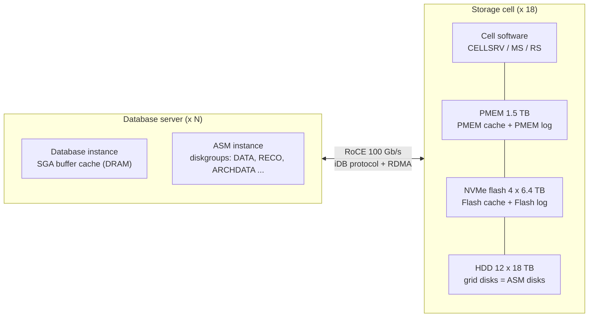
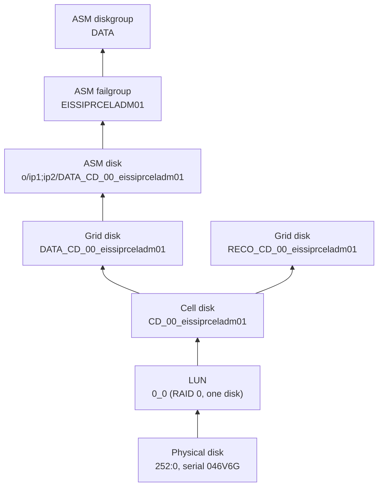
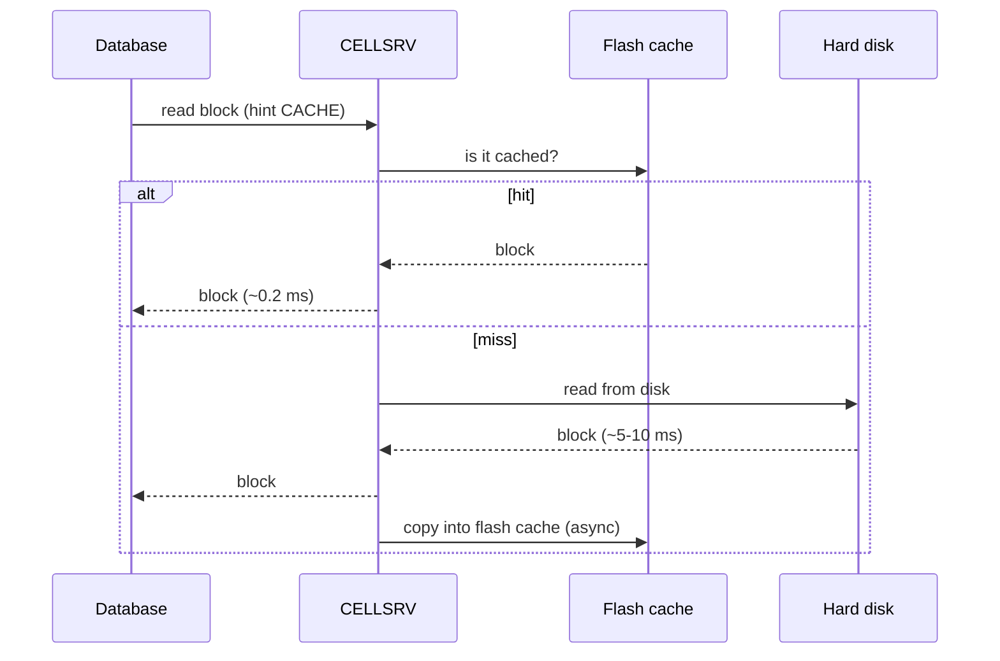
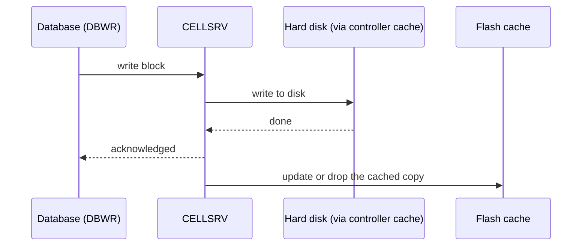
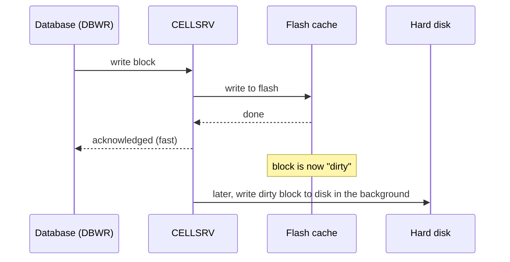
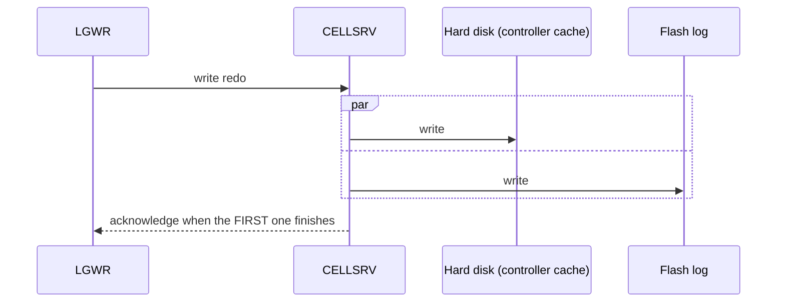
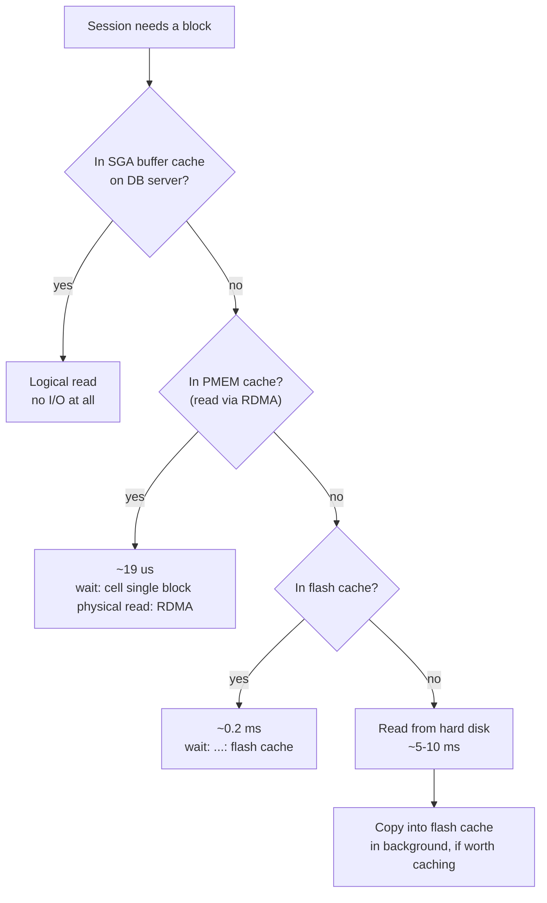
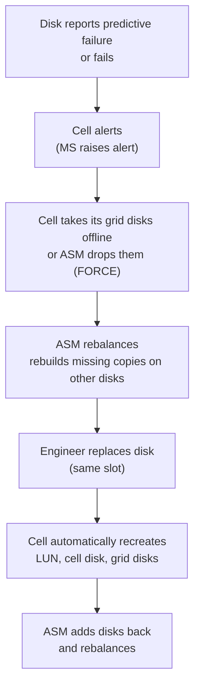

# Exadata X9M-2 storage: every component, flash and caching explained

Companion to [`x9m2_disk.sql`](x9m2_disk.sql), which reports the storage layers described here from inside the database.

Written for our X9M-2 High Capacity environment (prod cells `eissiprceladm01`-`18`, DR cells `eissidrceladm*`).
Hardware figures are the standard X9M-2 HC specification; confirm on your own cells with the commands given in each section.

---

## Contents

1. [The big picture](#1-the-big-picture)
2. [What is inside one storage cell](#2-what-is-inside-one-storage-cell)
3. [Cell software: CELLSRV, MS, RS](#3-cell-software-cellsrv-ms-rs)
4. [The storage layers, bottom to top](#4-the-storage-layers-bottom-to-top)
   - [4.1 Physical disk](#41-physical-disk)
   - [4.2 LUN](#42-lun)
   - [4.3 Cell disk](#43-cell-disk)
   - [4.4 Grid disk](#44-grid-disk)
   - [4.5 ASM disk](#45-asm-disk)
   - [4.6 ASM failgroup](#46-asm-failgroup)
   - [4.7 ASM diskgroup](#47-asm-diskgroup)
5. [How the layers map: a worked example](#5-how-the-layers-map-a-worked-example)
6. [The network between DB servers and cells](#6-the-network-between-db-servers-and-cells)
7. [Flash: what the NVMe cards are used for](#7-flash-what-the-nvme-cards-are-used-for)
8. [Smart Flash Cache: how data is cached](#8-smart-flash-cache-how-data-is-cached)
9. [WriteThrough vs WriteBack flash cache](#9-writethrough-vs-writeback-flash-cache)
10. [Smart Flash Log (redo)](#10-smart-flash-log-redo)
11. [PMEM: cache and log above flash](#11-pmem-cache-and-log-above-flash)
12. [The full read and write paths](#12-the-full-read-and-write-paths)
13. [The two "write cache" settings people confuse](#13-the-two-write-cache-settings-people-confuse)
14. [Smart Scan and storage indexes](#14-smart-scan-and-storage-indexes)
15. [IORM and flash cache sharing between databases](#15-iorm-and-flash-cache-sharing-between-databases)
16. [Redundancy and disk failure handling](#16-redundancy-and-disk-failure-handling)
17. [Our environment](#17-our-environment)
18. [LGWR and redo: how commits reach the cells](#18-lgwr-and-redo-how-commits-reach-the-cells)
19. [Command reference](#19-command-reference)
20. [Glossary](#20-glossary)

---

## 1. The big picture

An Exadata rack has two kinds of servers:

- **Database servers** (`eissiprdbadm01` ...): run the Oracle Database and ASM instances. They have **no local storage for database files**.
- **Storage servers, called cells** (`eissiprceladm01` ... `18`): hold all the data on hard disks, plus flash and persistent memory (PMEM) used as cache. They run Exadata Storage Server Software, which understands Oracle I/O.

They talk over a private **RoCE** (RDMA over Converged Ethernet) network at 100 Gb/s.



Two ideas to keep in mind for the rest of this guide:

1. **The hard disks are the permanent home of the data.** On High Capacity cells, flash and PMEM are caches in front of the hard disks.
2. **ASM mirrors data across cells.** A whole cell can go down without losing data.

---

## 2. What is inside one storage cell

Standard X9M-2 High Capacity storage server:

| Component | Quantity / size | Role |
|---|---|---|
| CPU | 2 x Intel Xeon (32 cores each) | Runs cell software, Smart Scan offload, decompression, decryption |
| DRAM | 256 GB | Cell software memory, storage indexes |
| PMEM (Intel Optane persistent memory) | 12 x 128 GB = 1.5 TB | PMEM cache and PMEM log |
| NVMe flash cards | 4 x 6.4 TB = 25.6 TB | Smart Flash Cache and Smart Flash Log |
| Hard disks | 12 x 18 TB 7,200 RPM = 216 TB raw | Grid disks that ASM uses as disks |
| M.2 SSDs | 2 (mirrored) | Cell operating system and software (system area) |
| RAID controller | 1, with battery or CacheVault-protected cache | Presents each hard disk as a LUN |
| Network | 2 x 100 Gb RoCE ports | Storage network to DB servers |

Speed of each layer (rough orders of magnitude):

| Layer | Typical read latency | Capacity per cell |
|---|---|---|
| PMEM via RDMA | ~ 19 microseconds | 1.5 TB |
| NVMe flash | ~ 100-250 microseconds | 25.6 TB |
| Hard disk | ~ 5-10 milliseconds | 216 TB |

Check on a cell:
```bash
cellcli -e list cell detail
cellcli -e list physicaldisk attributes name,diskType,makeModel,physicalSize,status
```

---

## 3. Cell software: CELLSRV, MS, RS

Three services run on every cell:

| Service | What it does |
|---|---|
| **CELLSRV** (Cell Server) | The main I/O engine. Receives I/O requests from the databases, serves blocks, runs Smart Scan, manages flash cache, flash log, PMEM cache, storage indexes and IORM. |
| **MS** (Management Server) | Handles `cellcli` commands, collects metrics, raises alerts, sends notifications, monitors hardware. |
| **RS** (Restart Server) | Watches CELLSRV and MS and restarts them if they die. |

Tools:

- **`cellcli`**: command line on a cell (`cellcli -e "list griddisk"`).
- **`dcli`**: runs the same command on many cells at once from a DB server (`dcli -g cell_group -l root "cellcli -e ..."`). `cell_group` is a text file listing cell hostnames.
- **ExaCLI**: remote `cellcli` without SSH, for restricted environments.

```bash
cellcli -e list cell attributes name,cellsrvStatus,msStatus,rsStatus
```

---

## 4. The storage layers, bottom to top

Every byte ASM stores passes through these layers:



This is exactly the chain `x9m2_disk.sql` walks:
`ASM diskgroup -> ASM disk -> grid disk -> cell disk -> physical disk -> LUN`.

### 4.1 Physical disk

The real device. Three kinds on X9M-2 HC (plus the M.2 system SSDs):

| Kind | Example name | diskType | Notes |
|---|---|---|---|
| Hard disk | `252:0` ... `252:11` | `HardDisk` | `252` = enclosure ID, `0`-`11` = slot. 18 TB each. |
| Flash | `FLASH_1_1`, `FLASH_4_1` ... | `FlashDisk` | NVMe cards in PCIe slots 1, 4, 6, 8. |
| PMEM | `PMEM_0_1` ... | `PMEM` | Optane modules in memory slots. |
| M.2 SSD | `M2_SYS_0`, `M2_SYS_1` | `M2Disk` | Cell OS only. Not used for data. |

Key attributes:

- `physicalSerial`: serial number, for example `046V6G`. Use it with the slot when a field engineer replaces a disk.
- `slotNumber`: physical slot.
- `status`: `normal`, `warning - predictive failure`, `failed`, `warning - poor performance`, `warning - confinedOnline` and others. Anything other than `normal` needs attention.
- `luns`: which LUN the disk belongs to.

```bash
dcli -g cell_group -l root "cellcli -e list physicaldisk attributes name,diskType,slotNumber,physicalSerial,status"
dcli -g cell_group -l root "cellcli -e list physicaldisk where status!=normal detail"
```

> Since X7, the cell's operating system lives on the two mirrored M.2 SSDs. All 12 hard disks are therefore fully available for data. On older generations the first two hard disks carried a small system area.

### 4.2 LUN

A LUN (logical unit) is how a device is presented to the cell's operating system.

**Hard disk LUNs** (`0_0` ... `0_11`)

- Created by the RAID controller.
- Each LUN is **one disk in RAID 0**. Exadata does not use hardware RAID across disks; ASM mirroring provides redundancy instead.
- The first number is the controller (`0`), the second the LUN number.
- Each has a **controller write cache mode** (`lunWriteCacheMode`):
  ```
  "WriteBack, ReadAheadNone, Direct, No Write Cache if Bad BBU"
  ```
  | Part | Meaning |
  |---|---|
  | `WriteBack` | The controller acknowledges a write once it is in its own battery-protected cache, and writes it to the platter shortly after. |
  | `ReadAheadNone` | The controller does no read-ahead. The cell software decides what to prefetch. |
  | `Direct` | Reads are not staged in the controller cache. |
  | `No Write Cache if Bad BBU` | If the battery (BBU) or CacheVault fails or is in a learn cycle, the controller **automatically switches to WriteThrough** so a power loss cannot lose acknowledged writes. |

  This is the healthy, expected setting on every hard disk LUN.

**Flash LUNs** (`1_0`, `4_0`, `6_0`, `8_0`): one per NVMe card, numbered by PCIe slot. No RAID controller is involved, so `lunWriteCacheMode` is empty.

**PMEM LUNs** (`P0_D1`, `P0_D3`, `P0_D7`, `P0_D8`, `P0_D12`, `P0_D14`, `P1_...`): `P0`/`P1` = CPU socket, `D` = DIMM slot. 6 per socket, 12 per cell. `lunWriteCacheMode` is empty.

You saw all three types in the `cellcli -e list lun attributes name,lunwritecachemode` output: only the `0_x` LUNs have a cache mode.

```bash
dcli -g cell_group -l root "cellcli -e list lun attributes name,diskType,raidLevel,lunWriteCacheMode,status"
```

### 4.3 Cell disk

A cell disk is the cell software's own object on top of one LUN. CELLSRV writes a small header on it and manages its space.

| Prefix | Built on | Count per cell |
|---|---|---|
| `CD_00` ... `CD_11` | Hard disk LUNs | 12 |
| `FD_00` ... `FD_03` | Flash LUNs | 4 |
| `PM_00` ... `PM_11` | PMEM LUNs | 12 |

Full names include the cell: `CD_00_eissiprceladm01`.

Key attributes: `deviceName` (Linux device, for example `/dev/sdb`), `physicalDisk` (serial of the disk underneath), `size`, `freeSpace`, `status`.

> `CD_00` is not always `/dev/sda`. Linux assigns device names in the order it discovers devices. In our DR output `CD_00` was `/dev/sdb` and `CD_01` was `/dev/sda`. That is normal. Always identify a disk by slot and serial, never by `/dev/sdX`.

```bash
dcli -g cell_group -l root "cellcli -e list celldisk attributes name,diskType,deviceName,size,freeSpace,status"
```

### 4.4 Grid disk

A grid disk is a **slice of a cell disk**. It is the unit ASM uses as a disk.

Each hard disk cell disk is normally divided into one grid disk per diskgroup:

```
CD_00_eissiprceladm01  (one 18 TB hard disk)
+---------------------------------------------+  offset 0 (outer tracks: fastest)
| DATA_CD_00_eissiprceladm01                  |
+---------------------------------------------+
| RECO_CD_00_eissiprceladm01                  |
+---------------------------------------------+
| (other diskgroups, for example ARCHDATA)    |
+---------------------------------------------+  end (inner tracks: slowest)
```

- Naming: `<PREFIX>_CD_<nn>_<cellname>`. The prefix normally equals the diskgroup name.
- The grid disk created first gets the outer, faster tracks. That is why DATA is created before RECO.
- Every cell disk in a diskgroup gets the same grid disk size, so ASM can balance evenly.
- In our DR screenshot each `EISDATA_CD_xx` grid disk was 14,293 GB.

Key attributes:

| Attribute | Meaning |
|---|---|
| `asmDiskGroupName`, `asmDiskName`, `asmFailGroupName` | What ASM uses it as |
| `cachingPolicy` | `default` = may be cached in flash/PMEM. `none` = never cached. |
| `status` | `active` or `inactive` |
| `asmModeStatus` | ASM's view: `ONLINE`, `SYNCING`, `OFFLINE`, `DROPPED`, `UNUSED` |
| `asmDeactivationOutcome` | `Yes` = safe to take this grid disk offline now (ASM still has mirror copies elsewhere). Check before rebooting a cell. |
| `offset`, `size` | Position and size on the cell disk |

```bash
dcli -g cell_group -l root "cellcli -e list griddisk attributes name,asmDiskGroupName,size,cachingPolicy,status,asmModeStatus"
dcli -g cell_group -l root "cellcli -e list griddisk attributes name,asmModeStatus,asmDeactivationOutcome"
```

### 4.5 ASM disk

ASM sees each grid disk as one disk. Its path is:

```
o/192.168.10.1;192.168.10.2/DATA_CD_00_eissiprceladm01
^ ^                         ^
| |                         grid disk name
| the cell's two RoCE IP addresses
"o" = Oracle's own storage protocol (iDB), not a Linux block device
```

The database never opens `/dev/sdX`. It sends iDB messages to CELLSRV, which does the I/O.

In the database the cell is identified by this IP pair. `v$cell_config.cellname` holds it, and the script joins on `'o/' || cellname || '/' || griddisk`.

```sql
SELECT name, path, failgroup, mode_status, state, total_mb, free_mb
FROM   v$asm_disk_stat
ORDER  BY failgroup, name;
```

### 4.6 ASM failgroup

A failgroup is a set of disks that can fail together. On Exadata **each cell is one failgroup**, named after the cell (`EISSIPRCELADM01`).

ASM never puts two copies of the same data in the same failgroup. So with NORMAL redundancy (2 copies) or HIGH redundancy (3 copies), losing a whole cell loses at most one copy of anything.

### 4.7 ASM diskgroup

A diskgroup combines the same-named grid disks from every cell disk on every cell it uses.

Example: DATA on 18 cells x 12 disks = 216 ASM disks.

| Diskgroup | Typical use |
|---|---|
| DATA | Datafiles, control files, online redo |
| RECO | Fast Recovery Area: archive logs, flashback logs, RMAN backups, control file copies |
| ARCHDATA (ours) | Archive / historical data |

Redundancy:

| Type | Copies | Survives | Exadata recommendation |
|---|---|---|---|
| NORMAL | 2 | 1 cell or disk failure | Acceptable for RECO / test |
| HIGH | 3 | 2 simultaneous failures | Recommended for DATA |

Allocation unit (AU) size on Exadata is normally **4 MB**. ASM stripes each file across all disks in the diskgroup in AU-sized pieces, so every disk on every cell works on every large I/O.

```sql
SELECT name, type, allocation_unit_size/1024/1024 au_mb,
       total_mb/1024 total_gb, free_mb/1024 free_gb, usable_file_mb/1024 usable_gb
FROM   v$asm_diskgroup_stat;
```

---

## 5. How the layers map: a worked example

One row from our DR output, read across:

| Layer | Value |
|---|---|
| ASM diskgroup | `EISDATA` |
| Cell | `eissidrceladm01` |
| ASM disk | `EISDATA_CD_00_EISSIDRCELADM01`, mode `ONLINE` |
| Grid disk | `EISDATA_CD_00_eissidrceladm01`, 14,293 GB |
| Cell disk | `CD_00_eissidrceladm01` |
| Linux device | `/dev/sdb` |
| Physical disk | `252:0`, serial `04732G`, slot 0, status `normal` |
| LUN | `0_0`, RAID 0, `WriteBack, ReadAheadNone, Direct, No Write Cache if Bad BBU` |

So if `04732G` fails, ASM loses `EISDATA_CD_00_EISSIDRCELADM01` (and the same-numbered grid disks of other diskgroups on that cell disk) and rebuilds from mirror copies on other cells.

---

## 6. The network between DB servers and cells

| Generation | Network |
|---|---|
| Up to X8 | InfiniBand (40 Gb/s QDR) |
| X8M, X9M, X10M | RoCE, 100 Gb/s, two ports per server |

- **iDB** (Intelligent Database protocol) runs on top of RDS (Reliable Datagram Sockets). It carries normal block I/O, Smart Scan requests and results, and cache hints.
- **RDMA**: the database server can read directly from a cell's PMEM without going through CELLSRV. That is why PMEM reads take about 19 microseconds.

```bash
# on a DB server
cat /etc/oracle/cell/network-config/cellip.ora   # list of cell IP pairs the DB uses
```

---

## 7. Flash: what the NVMe cards are used for

Each of the 4 flash cell disks (`FD_00` ... `FD_03`) is split into:

```
FD_00_eissiprceladm01 (6.4 TB NVMe)
+--------------------------------------------+
| Flash Log   small, for redo writes         |
+--------------------------------------------+
| Flash Cache the rest: cache in front of    |
|             the hard disks                 |
+--------------------------------------------+
```

| Use | Purpose | Section |
|---|---|---|
| **Smart Flash Cache** | Caches hot data blocks from the hard disks. Read cache always; write cache too in WriteBack mode. | [8](#8-smart-flash-cache-how-data-is-cached), [9](#9-writethrough-vs-writeback-flash-cache) |
| **Smart Flash Log** | Speeds up redo log writes (commits). | [10](#10-smart-flash-log-redo) |
| Flash grid disks (optional) | Grid disks directly on flash, as permanent storage. Standard on **Extreme Flash** cells; unusual on High Capacity cells. | - |

On High Capacity cells, flash does **not** hold the permanent copy of the data. If the whole flash cache were dropped, no data would be lost (in WriteThrough mode; in WriteBack mode the dirty blocks are flushed first).

```bash
dcli -g cell_group -l root "cellcli -e list flashcache detail"
dcli -g cell_group -l root "cellcli -e list flashlog detail"
dcli -g cell_group -l root "cellcli -e list celldisk where diskType=FlashDisk attributes name,size,freeSpace,status"
```

---

## 8. Smart Flash Cache: how data is cached

### 8.1 It is a smart cache, not an LRU of everything

A plain cache keeps whatever was read last. Exadata's flash cache is "smart" because **the database tells the cell what each I/O is**, and the cell decides whether caching it is worth it.

Each I/O from the database carries a hint:

| Hint | Sent for | Cell action |
|---|---|---|
| CACHE | Normal single-block reads and writes of tables and indexes, control file I/O | Cache it |
| NOCACHE | Backups, Data Pump, archive log and redo writes, large sequential scans (by default) | Do not cache |
| EVICT | Data that is being freed (for example ASM rebalance moving it away) | Remove it from cache |
| KEEP | Objects with `CELL_FLASH_CACHE KEEP` | Cache with priority |

### 8.2 What gets cached and what does not

| Cached (default) | Not cached (default) |
|---|---|
| Single-block reads: index lookups, OLTP row fetches by ROWID | RMAN backup and restore I/O |
| Small multi-block reads | Data Pump export/import I/O |
| Control file reads | Archive log writes |
| Frequently scanned tables, partially (scan awareness: if a table is scanned repeatedly and fits, part of it is cached) | Redo writes (handled by Flash Log instead) |
| HCC data, converted into a pure columnar layout in flash ("columnar flash cache") | Reads of secondary ASM mirror copies (reads normally use the primary copy, so only it is read-cached; in WriteBack mode written mirror copies are still kept in flash on their own cells) |
| Anything marked `CELL_FLASH_CACHE KEEP` | Objects marked `CELL_FLASH_CACHE NONE` |
| | Grid disks with `cachingPolicy=none` |

### 8.3 Controlling caching

Per object (table, index, partition, LOB):
```sql
ALTER TABLE  sales          STORAGE (CELL_FLASH_CACHE KEEP);     -- cache with priority, also for scans
ALTER TABLE  audit_history  STORAGE (CELL_FLASH_CACHE NONE);     -- never cache
ALTER INDEX  sales_pk       STORAGE (CELL_FLASH_CACHE DEFAULT);  -- let the cell decide

SELECT owner, segment_name, segment_type, cell_flash_cache
FROM   dba_segments
WHERE  cell_flash_cache <> 'DEFAULT';
```

Per grid disk (affects every object in that diskgroup on that cell):
```bash
cellcli -e alter griddisk ARCHDATA_CD_00_eissiprceladm04 cachingPolicy=none
```

Per database (IORM flash cache quotas): see [section 15](#15-iorm-and-flash-cache-sharing-between-databases).

### 8.4 How a block gets into the cache (read)



On a miss the block is returned to the database first and copied into flash in the background, so caching never slows the request down.

### 8.5 Eviction

When the flash cache is full, the cell evicts the least valuable data: blocks not read for a long time, and scan data before OLTP data. `KEEP` objects are evicted last (they can use up to about 80% of the cache by default).

### 8.6 Flash cache compression

X5 and later cells can compress data in flash cache transparently to fit more. It is configured at cell level (`flashCacheCompress`) and depends on software version and licensing.

### 8.7 Watching the flash cache

Cell metrics:
```bash
dcli -g cell_group -l root "cellcli -e list metriccurrent where objectType='FLASHCACHE' and name like 'FC_(IO_RQ_R|IO_RQ_R_MISS|BY_USED|BY_DIRTY).*'"
```

| Metric | Meaning |
|---|---|
| `FC_IO_RQ_R` | Read requests satisfied from flash cache |
| `FC_IO_RQ_R_MISS` | Read requests that missed flash cache |
| `FC_BY_USED` | Bytes of flash cache in use |
| `FC_BY_DIRTY` | Bytes in flash not yet written to disk (WriteBack only) |

Database statistics:
```sql
SELECT name, value
FROM   v$sysstat
WHERE  name IN ('cell flash cache read hits',
                'cell pmem cache read hits',
                'physical read total IO requests',
                'cell physical IO bytes eligible for predicate offload',
                'cell physical IO interconnect bytes returned by smart scan');
```

Flash hit ratio (approximate) = `cell flash cache read hits` / `physical read total IO requests`.

Wait events (19c+ splits single-block reads by source):

| Wait event | Read served from |
|---|---|
| `cell single block physical read: RDMA` | PMEM via RDMA |
| `cell single block physical read: pmem cache` | PMEM via CELLSRV |
| `cell single block physical read: flash cache` | Flash |
| `cell single block physical read` | Hard disk |
| `cell smart table scan` | Smart Scan |

---

## 9. WriteThrough vs WriteBack flash cache

`flashCacheMode` is a **cell-level** attribute. It applies to all diskgroups on that cell.

### 9.1 WriteThrough



- Writes always go to the hard disk.
- Flash only speeds up **reads**.
- Flash never holds data newer than disk, so a flash card failure only means a colder cache.
- Write throughput is limited by the hard disks.

### 9.2 WriteBack



- Writes go to flash and are acknowledged immediately.
- Flash speeds up **reads and writes**. Helps write-heavy workloads: high DBWR activity, `free buffer waits`, large batch updates.
- Repeated writes to the same block are absorbed in flash; the disk sees only the final version.
- Until written back, the newest copy of a dirty block exists only in flash. It stays safe because:
  - flash is persistent (survives cell reboot);
  - ASM writes every block to 2 or 3 cells, and each cell keeps its copy in its own flash;
  - if a flash card fails, CELLSRV recovers the lost dirty data from mirror copies on other cells ("resilvering").

### 9.3 Comparison

| | WriteThrough | WriteBack |
|---|---|---|
| Read caching | Yes | Yes |
| Write caching | No | Yes |
| Write latency | Hard disk (controller cache helps) | Flash |
| Write IOPS | Limited by disks | Much higher |
| Flash card failure | Cache lost, no data at risk | Dirty data rebuilt from ASM mirrors |
| Good for | Read-mostly data, archive, reporting | OLTP, write-heavy batch, busy DBWR |

### 9.4 Changing the mode

The flash cache must be dropped and recreated, one cell at a time. Plan a maintenance window and follow the current Oracle Support note for your software version.

WriteThrough to WriteBack (per cell):
```bash
cellcli -e drop flashcache
cellcli -e alter cell flashCacheMode=WriteBack
cellcli -e create flashcache all
```

WriteBack to WriteThrough (per cell): dirty data must be flushed to disk first, which can take a long time.
```bash
cellcli -e alter flashcache all flush          # wait until FC_BY_DIRTY = 0
cellcli -e list metriccurrent FC_BY_DIRTY
cellcli -e drop flashcache
cellcli -e alter cell flashCacheMode=WriteThrough
cellcli -e create flashcache all
```

Check:
```bash
dcli -g cell_group -l root "cellcli -e list cell attributes name,flashCacheMode"
```

---

## 10. Smart Flash Log (redo)

Commits wait for LGWR to write redo (`log file sync`). A hard disk write is usually fast thanks to the controller cache, but occasionally takes much longer, and those outliers hurt commit times.

Smart Flash Log fixes the outliers:



- Redo is written to the hard disk **and** to flash log in parallel.
- Whichever finishes first is acknowledged.
- Flash log is only a temporary staging area. The redo always ends up in the online redo log files on disk.
- Flash log is small (by default about 512 MB per cell) because it only holds redo until the disk write completes.

```bash
dcli -g cell_group -l root "cellcli -e list flashlog attributes name,size,status"
dcli -g cell_group -l root "cellcli -e list metriccurrent where objectType='FLASHLOG'"
```

For the full LGWR write path, PMEM log, and an analysis of our own LGWR statistics, see [section 18](#18-lgwr-and-redo-how-commits-reach-the-cells).

---

## 11. PMEM: cache and log above flash

X8M and X9M cells add **persistent memory** (Intel Optane): byte-addressable like DRAM but keeps data across power loss. Each cell has 12 modules (`P0_D*`, `P1_D*` LUNs, `PM_*` cell disks).

### 11.1 PMEM cache

- Holds the **hottest** blocks, above flash cache.
- The database server reads it with **RDMA**: the DB server's network card reads directly from the cell's PMEM, with no CELLSRV involvement and no interrupt. About 19 microseconds.
- Blocks enter PMEM cache from flash cache when they are read very frequently.
- Normally runs **WriteThrough** (attribute `pmemCacheMode`), Oracle's recommended setting.

### 11.2 PMEM log

- Same idea as flash log, one level faster: LGWR writes redo to PMEM log using RDMA, and the cell then writes it to disk.
- Cuts commit latency further.

```bash
dcli -g cell_group -l root "cellcli -e list cell attributes name,pmemCacheMode"
dcli -g cell_group -l root "cellcli -e list pmemcache detail"
dcli -g cell_group -l root "cellcli -e list pmemlog detail"
```

> X10M replaced Optane PMEM with ordinary DRAM used the same way, called **XRMEM** (Exadata RDMA Memory). The concept is unchanged.

---

## 12. The full read and write paths

### 12.1 Single-block read (for example an index lookup)



### 12.2 Full table scan (Smart Scan)

1. The database sends the **query predicate and column list** to every cell holding the table's extents.
2. Each cell checks its **storage index** and skips 1 MB regions that cannot match.
3. It reads the remaining data (from flash if cached, otherwise disk), filters rows, keeps only needed columns, decompresses HCC.
4. Only matching rows and columns travel back over the network.

### 12.3 Block write (DBWR)

| Cell flash mode | Path |
|---|---|
| WriteThrough | DBWR -> CELLSRV -> hard disk (controller WriteBack cache) -> ack. Flash copy updated or dropped. |
| WriteBack | DBWR -> CELLSRV -> flash -> ack. Written to hard disk later. |

ASM sends every write to 2 or 3 cells (one per mirror copy), in parallel.

### 12.4 Redo write (LGWR)

LGWR -> PMEM log (RDMA) and/or flash log and hard disk in parallel -> ack on first completion -> redo always lands in the online redo log on disk.

---

## 13. The two "write cache" settings people confuse

This came up on our ARCHDATA diskgroup: the old script showed WriteBack, but the cells were WriteThrough. Both were true, because they are different caches.

| Setting | Where | Object | Values | What it controls |
|---|---|---|---|---|
| `lunWriteCacheMode` | RAID controller | One per **hard disk LUN** | Normally `WriteBack, ..., No Write Cache if Bad BBU` | A small battery-protected cache on the controller. Drops to WriteThrough only if the battery/CacheVault fails. |
| `flashCacheMode` | Cell software | One per **cell** | `WriteBack` or `WriteThrough` | Whether the **flash cache** caches writes too, or only reads. |
| `cachingPolicy` | Cell software | One per **grid disk** | `default` or `none` | Whether that grid disk uses flash/PMEM cache at all. |
| `pmemCacheMode` | Cell software | One per **cell** | Normally `WriteThrough` | Same as flashCacheMode, for the PMEM cache. |

`x9m2_disk.sql` v4 shows them side by side as `LUN_CTRL_CACHE`, `CELL_FLASH_CACHE` and `GD_CACHING`, and section 5 of the script summarises them per diskgroup and cell.

---

## 14. Smart Scan and storage indexes

### 14.1 Smart Scan (offload)

When a query does a direct-path full scan of a table or index, the database can push work to the cells:

| Offloaded work | Effect |
|---|---|
| Predicate filtering (`WHERE`) | Only matching rows return |
| Column projection | Only needed columns return |
| Join filtering (Bloom filters) | Rows that cannot join are dropped at the cell |
| HCC decompression | Done on cell CPUs |
| Decryption (TDE) | Done on cell CPUs |
| Some functions, aggregation on HCC | Done at the cell |

Requirements: direct-path read (usually serial large scans or parallel query), object on Exadata storage, `cell_offload_processing=TRUE` (default).

Check whether a query used it:
```sql
SELECT sql_id,
       io_cell_offload_eligible_bytes/1024/1024 eligible_mb,
       io_interconnect_bytes/1024/1024           interconnect_mb,
       io_cell_offload_returned_bytes/1024/1024  returned_mb
FROM   v$sql
WHERE  sql_id = '&sql_id';
```

### 14.2 Storage indexes

- Kept in **cell memory**, built automatically, never stored on disk.
- For each **1 MB region** of a grid disk, the cell remembers min/max values of frequently filtered columns, and whether NULLs exist.
- During Smart Scan, regions that cannot contain matching rows are skipped without any I/O.
- Lost when CELLSRV restarts (rebuilt as queries run; newer versions persist them).

```sql
SELECT value/1024/1024/1024 gb_saved
FROM   v$sysstat
WHERE  name = 'cell physical IO bytes saved by storage index';
```

---

## 15. IORM and flash cache sharing between databases

**I/O Resource Manager (IORM)** runs inside CELLSRV and decides whose I/O goes first when several databases share the cells.

- `dbplan`: shares or limits per database.
- Consumer groups inside a database (DBRM) are honoured on the cells too.
- **Flash cache quotas**: `flashCacheMin`, `flashCacheLimit`, `flashCacheSize` per database stop one database from filling the whole cache.
- `objective`: `auto` (default), `low_latency`, `high_throughput`, `balanced`.

```bash
dcli -g cell_group -l root "cellcli -e list iormplan detail"

# example: guarantee PROD 10 TB of flash cache per cell, cap TEST at 2 TB
cellcli -e alter iormplan dbplan=((name=PROD, share=8, flashCacheMin=10T), (name=TEST, share=2, flashCacheLimit=2T), (name=default, share=1))
```

---

## 16. Redundancy and disk failure handling

### 16.1 What happens when a hard disk fails



- **Predictive failure**: disk still works but is expected to fail. Exadata proactively drops it and rebalances while it is still readable.
- **Poor performance**: Exadata detects a disk that is much slower than its peers and takes it out (`warning - poor performance`, "confined") so one slow disk does not slow the whole diskgroup.
- **Disk replacement** is hot-swappable. After replacement, no manual `CREATE GRIDDISK` or `ALTER DISKGROUP ADD` is normally needed.

### 16.2 Short outages: disk_repair_time

If a cell is rebooted or a disk goes offline briefly, ASM marks disks OFFLINE and tracks changed extents. When they come back within the repair time, ASM only resyncs the changes (`SYNCING`), instead of a full rebalance.

```sql
SELECT g.name, a.name attr, a.value
FROM   v$asm_attribute a JOIN v$asm_diskgroup g ON g.group_number = a.group_number
WHERE  a.name IN ('disk_repair_time','failgroup_repair_time','compatible.asm','au_size');
```
Defaults: `disk_repair_time` 3.6h, `failgroup_repair_time` 24h.

### 16.3 Before rebooting or patching a cell

```bash
# 1. every grid disk must say Yes
cellcli -e list griddisk attributes name,asmmodestatus,asmdeactivationoutcome
# 2. take grid disks offline cleanly
cellcli -e alter griddisk all inactive
# 3. after the cell is back
cellcli -e alter griddisk all active
# 4. wait until all are ONLINE (not SYNCING) before touching the next cell
cellcli -e list griddisk attributes name,asmmodestatus
```

### 16.4 Flash card failure

| Flash mode | Effect |
|---|---|
| WriteThrough | Only cached data lost. Reads go to disk until cache warms up again. |
| WriteBack | Dirty data on that card is rebuilt from ASM mirror copies on other cells. |

---

## 17. Our environment

### 17.1 Prod cell flash cache modes (from `cellcli`, 23-Nov-2026)

| Cells | flashCacheMode |
|---|---|
| eissiprceladm01 - 03 | WriteBack |
| eissiprceladm04 - 09 | **WriteThrough** |
| eissiprceladm10 - 12 | WriteBack |
| eissiprceladm13 - 18 | **WriteThrough** |

All hard disk LUNs (`0_0` - `0_11`) on all cells: `WriteBack, ReadAheadNone, Direct, No Write Cache if Bad BBU` (healthy).
Flash LUNs `1_0, 4_0, 6_0, 8_0` and PMEM LUNs `P0_D*, P1_D*`: no controller cache (expected).

ARCHDATA sits on the WriteThrough cells. Its flash cache only accelerates reads, which suits archive data.

### 17.2 Things to check regularly

| Check | Command |
|---|---|
| Any non-normal physical disk | `dcli -g cell_group -l root "cellcli -e list physicaldisk where status!=normal"` |
| Grid disks not ONLINE | `dcli -g cell_group -l root "cellcli -e list griddisk where asmModeStatus!=ONLINE attributes name,asmModeStatus"` |
| LUN cache dropped to WriteThrough (battery issue) | `dcli -g cell_group -l root "cellcli -e list lun attributes name,lunWriteCacheMode" \| grep -i writethrough` |
| Open alerts | `dcli -g cell_group -l root "cellcli -e list alerthistory where examinedBy='' and severity!='clear'"` |
| Flash cache mode per cell | `dcli -g cell_group -l root "cellcli -e list cell attributes name,flashCacheMode"` |
| Full topology from SQL | `@x9m2_disk.sql` |

---

## 18. LGWR and redo: how commits reach the cells

This section explains how LGWR writes redo on X9M-2, then works through a real Snapper sample of LGWR from `EISSIDRDB01` (instance 1, about 35 seconds, 23-Nov-2026).

### 18.1 Our redo log layout

| Item | Value |
|---|---|
| Groups per thread | 10 |
| Members per group | 2: one in `+EISDATA`, one in `+EISRECO` |
| Member size | 10 GB |
| Diskgroup redundancy | HIGH for both (3 copies of every extent, on 3 different cells) |
| Copies of each redo block | 2 members x 3 mirror copies = **6** |
| Redo space per thread (logical) | 10 groups x 10 GB = 100 GB before the logs wrap |
| Raw space per thread | 10 x 2 x 10 GB x 3 = **600 GB** (300 GB in each diskgroup) |

EISDATA and EISRECO are grid disk slices of the **same physical disks** on the same cells. The second member protects against file-level and diskgroup-level problems (a deleted or corrupted member, a dismounted diskgroup). Protection against hardware failure comes from HIGH redundancy.

### 18.2 How a commit is written, step by step

1. A session changes data. Redo goes into the **log buffer** in the SGA, split into several **strands** so sessions do not block each other.
2. The session commits. It posts LGWR and waits on **`log file sync`**.
3. **Gather.** LGWR copies the redo out of the strands and builds the write. This is CPU work.
4. **Schedule and issue.** LGWR sends one asynchronous write per log member through ASM. ASM turns each member write into one write per mirror copy. In our setup: 2 members x 3 copies = 6 writes to 6 cell targets, all at the same time.
5. **On each cell**, the write is made durable in the fastest persistent place available:
   - **PMEM log (X8M/X9M, called XRMEM on newer software).** The DB server's network card writes the redo straight into the cell's persistent memory using RDMA. CELLSRV and the cell CPU are not involved in the acknowledgement. This takes tens of microseconds.
   - **Smart Flash Log** (when PMEM log is not used). CELLSRV writes the redo to the flash log and to the hard disk (through the RAID controller cache) **in parallel**, and acknowledges whichever finishes first. This hides the occasional slow disk write.
6. **Finish.** LGWR waits until **all** copies have acknowledged. The slowest of the six decides the time. The part of this wait where LGWR is actually blocked shows as **`log file parallel write`**.
7. **Post.** LGWR wakes the waiting sessions (or they find out by polling, with adaptive log file sync). Their commit is complete.
8. **Later, in the background**, the cell writes the redo to the online redo log file on disk and frees the space in PMEM log or flash log.

Important points:

- PMEM log and flash log are **staging areas, not the redo log**. The redo always ends up in the online redo log files in ASM.
- Both are persistent. If a cell crashes between step 5 and step 8, the cell replays the log when it starts, so acknowledged redo is never lost.
- PMEM log and flash log are small (flash log is about 512 MB per cell by default) because they only hold redo until the disk write completes.
- LGWR has worker processes (`LG00`-`LGnn`, scalable LGWR). At moderate load the main LGWR does all the work and the workers show `LGWR worker group idle`. Oracle switches between single and parallel mode on its own.

### 18.3 Reading the LGWR Snapper output

Sample length: `physical write total bytes` 1,706,112,000 at 48.22 MB/s gives about **35.4 seconds**.

#### Volume and write sizes

| Statistic | Value | Meaning |
|---|---|---|
| `redo writes` | 123,896 (3.5k per second) | Number of LGWR writes. 3,500 per second means a commit-heavy (OLTP) workload. |
| `redo blocks written` | 1,666,197 | Redo blocks are 512 bytes: 1,666,197 x 512 = **853 MB**, about **24 MB/s** of redo. |
| Average write size | 853 MB / 123,896 | **About 6.9 KB.** Small writes, typical of many small commits. |
| `redo write size count (4KB)` | 71,910 | 58% of writes are 4 KB or less |
| `redo write size count (8KB)` | 23,404 | together with 4 KB: 77% are 8 KB or less |
| `redo write size count (16KB)` | 12,903 | |
| `redo write size count (32KB)` | 12,231 | |
| `redo write size count (128KB)` | 3,409 | |
| `redo write size count (256KB/512KB/1024KB)` | 18 / 19 / 3 | Large writes are rare. All size buckets add up to 123,897, matching `redo writes`. |
| `redo wastage` | 45,313,608 bytes | About 5% of redo is padding. Each write is rounded up to a whole 512-byte block, so many small commits produce some waste. Normal for this workload. |
| `redo writes coalesced` | 62,083 | About half the writes combined redo from more than one strand into one I/O. |
| `redo write active strands` | 188,790 | About 1.5 strands contributed to each write on average. |
| `redo blocks checksummed by FG (exclusive)` | 864,149 | Sessions computed about half of the redo block checksums themselves, taking that CPU work off LGWR. |
| `calls to kcmgas` | 124,332 | SCN allocation calls, roughly one per redo write. |

#### How one redo write turns into many physical writes

| Statistic | Value | Explanation |
|---|---|---|
| Redo generated | 853 MB | from `redo blocks written` |
| `physical write total IO requests` | 247,796 | exactly **2 x** `redo writes`: one write per member |
| `physical write total bytes` | 1,706,112,000 | **2 x** 853 MB: the EISDATA member plus the EISRECO member |
| `cell physical IO interconnect bytes` | 5,118,925,824 (144.66 MB/s) | **3 x** 1,706 MB (HIGH redundancy sends each write to 3 cells) plus 589,824 bytes of reads |

So **24 MB/s of redo becomes about 144 MB/s of writes on the storage network and cells.** The archiver adds more on top: it reads every filled log and writes the archive log (3 more copies if the archive destination is a HIGH redundancy diskgroup).

#### Where the time goes in one redo write

The `redo write ... time` statistics are cumulative from the start of each write. Dividing by `redo writes` gives:

| Statistic | Cumulative per write | This phase alone | What happens |
|---|---|---|---|
| `redo write gather time` | 35.22 us | **35.2 us** | LGWR collects redo from the strands (CPU) |
| `redo write schedule time` | 37.54 us | 2.3 us | Prepares the I/O |
| `redo write issue time` | 37.61 us | 0.07 us | Hands the I/O to ASM and the cells |
| `redo write finish time` | 72.98 us | **35.4 us** | **The I/O itself: 6 writes to PMEM/XRMEM log over RDMA, wait for all** |
| `redo write total time` | 77.24 us | 4.3 us | Post-processing, posting the waiting sessions |

`redo write time (usec)` 9,076,225 / 123,896 = **73.26 us** per write confirms this.

About 35 us for six parallel writes is RDMA-to-persistent-memory speed. Flash would typically take 150-300 us and a hard disk milliseconds. **Storage is not the bottleneck: LGWR spends as long gathering redo from memory as it does waiting for the I/O.**

#### Wait events and LGWR busy time

| Event / statistic | Value | Meaning |
|---|---|---|
| `rdbms ipc message` | 73% of elapsed time, 141 us average | LGWR is idle about 73% of the time, waiting for work |
| `background cpu time` | 295 ms per second | LGWR is on CPU about 30% of the time. Plenty of headroom. |
| `log file parallel write` | 125,484 waits, **11.6 us** average, 4.1% of time | Only the part of each I/O where LGWR is actually blocked. Lower than the 35 us I/O phase because LGWR checks for completion by polling (`ASM IO for non-blocking poll`, 7.2 us average) and does other work meanwhile. |
| `control file sequential read` | 5,945 waits, **20 us** average | Control file reads at RDMA speed |
| `cell xrmem cache read hits` | 36 | Equals `physical read requests optimized` (36): every physical read LGWR did came from XRMEM (PMEM) cache |
| `Disk file Mirror Read` | 12 waits, 168 us | Negligible |
| `redo write broadcast ack time / count` | 4,721 us / 60 | RAC commit SCN broadcasts, about 79 us each, only 60 of them. Negligible. |
| `LGWR worker group idle` (LG01-LG07) | 100% idle | Workers not needed at this load. Normal. |

### 18.4 Log switch rate and capacity

Based on the 24 MB/s sample. Check the real peak with the query below before changing anything.

| Item | Calculation | Result |
|---|---|---|
| Time to fill one 10 GB member | 10,240 MB / 24 MB/s | about 7 minutes |
| Log switches per hour | 60 / 7 | about 8-9 |
| Time to cycle through all 10 groups | 10 x 7 min | about 70 minutes |

- A common target is a log switch every 15-20 minutes at peak (3-4 per hour). At 24 MB/s we switch about every 7 minutes. Switches are cheap with 10 GB logs, so this is not a problem. If this rate is the normal peak, 20 GB members would bring it nearer the target.
- The archiver has about 70 minutes to archive each log before LGWR needs it again. `log file switch (archiving needed)` would only appear if archiving stopped, for example because the archive destination filled up.
- If this database is a Data Guard primary, standby redo logs should be the same size (10 GB) with the same number of groups per thread as the online logs (Oracle's current guidance).

### 18.5 One member or two on HIGH redundancy

Oracle's Exadata MAA guidance says one member per group is enough when redo is on a HIGH redundancy diskgroup, because ASM already keeps 3 copies on 3 cells. Check the current MAA paper for your version before changing anything.

| | 2 members (current) | 1 member in EISDATA |
|---|---|---|
| Copies of each redo block | 6 | 3 |
| Survives 2 cell failures | Yes | Yes |
| Survives a deleted or corrupted member file | Yes | No |
| Survives losing a whole diskgroup | Yes | No |
| Cell writes per redo write | 6 | 3 |
| Raw space per thread | 600 GB | 300 GB |

**Decision: keep 2 members.** Redo writes complete in about 35 us and LGWR is about 30% busy, so the second member costs nothing noticeable. Revisit only if space is needed or commit latency becomes a problem.

### 18.6 Commands

```sql
-- commit latency as sessions see it (should be close to LGWR's ~77 us plus wake-up time)
SELECT event, total_waits,
       ROUND(time_waited_micro/NULLIF(total_waits,0),1) avg_us
FROM   v$system_event
WHERE  event IN ('log file sync','log file parallel write');

-- redo layout
SELECT l.group#, l.thread#, l.members, l.bytes/1024/1024/1024 gb, l.status, f.member
FROM   v$log l JOIN v$logfile f ON f.group# = l.group#
ORDER  BY l.thread#, l.group#;

-- log switches per hour, last 7 days, per thread
SELECT TO_CHAR(first_time,'YYYY-MM-DD HH24') hour, thread#, COUNT(*) switches
FROM   v$log_history
WHERE  first_time > SYSDATE - 7
GROUP  BY TO_CHAR(first_time,'YYYY-MM-DD HH24'), thread#
ORDER  BY 1, 2;

-- redo generated per hour (MB), last 7 days
SELECT TO_CHAR(first_time,'YYYY-MM-DD HH24') hour, thread#,
       ROUND(SUM(blocks*block_size)/1024/1024) redo_mb
FROM   v$archived_log
WHERE  first_time > SYSDATE - 7 AND dest_id = 1
GROUP  BY TO_CHAR(first_time,'YYYY-MM-DD HH24'), thread#
ORDER  BY 1, 2;

-- LGWR statistics like the Snapper sample (Tanel Poder's snapper.sql)
-- @snapper all 30 1 lgwr
```

```bash
# flash log and PMEM/XRMEM log on each cell
dcli -g cell_group -l root "cellcli -e list flashlog attributes name,size,status"
dcli -g cell_group -l root "cellcli -e list pmemlog detail"      # newer software may name it xrmemlog

# flash log race results and prevented outliers
dcli -g cell_group -l root "cellcli -e list metriccurrent where name like 'FL_.*(FIRST|OUTLIERS)'"

# metric names differ between versions; list what this version has
cellcli -e list metricdefinition where objectType like '.*LOG'
```

| Flash log metric | Meaning |
|---|---|
| `FL_DISK_FIRST` | Redo writes where the hard disk finished first |
| `FL_FLASH_FIRST` | Redo writes where flash finished first |
| `FL_PREVENTED_OUTLIERS` | Slow disk writes that flash log hid from LGWR |
| `FL_ACTUAL_OUTLIERS` | Slow writes flash log could not hide |

---

## 19. Command reference

### cellcli / dcli

```bash
# cell
cellcli -e list cell detail
cellcli -e list cell attributes name,flashCacheMode,pmemCacheMode,cellsrvStatus,msStatus,rsStatus

# layers
cellcli -e list physicaldisk attributes name,diskType,slotNumber,physicalSerial,status
cellcli -e list lun attributes name,diskType,raidLevel,lunWriteCacheMode,status
cellcli -e list celldisk attributes name,diskType,deviceName,size,freeSpace,status
cellcli -e list griddisk attributes name,asmDiskGroupName,size,cachingPolicy,status,asmModeStatus

# caches and logs
cellcli -e list flashcache detail
cellcli -e list flashlog detail
cellcli -e list pmemcache detail
cellcli -e list pmemlog detail
cellcli -e list flashcachecontent where objectNumber=12345 detail

# metrics and alerts
cellcli -e list metriccurrent where objectType='FLASHCACHE'
cellcli -e list metriccurrent where objectType='CELLDISK' and name='CD_IO_TM_R_SM_RQ'
cellcli -e list alerthistory

# IORM
cellcli -e list iormplan detail

# run on all cells from a DB server
dcli -g ~/cell_group -l root "cellcli -e list cell attributes name,flashCacheMode"
```

### SQL

```sql
-- full topology, all caches, per diskgroup summary
@x9m2_disk.sql

-- ASM view
SELECT name, failgroup, mode_status, state, path FROM v$asm_disk_stat ORDER BY failgroup, name;
SELECT name, type, total_mb, free_mb, usable_file_mb FROM v$asm_diskgroup_stat;

-- cell config as the DB sees it (XML)
SELECT cellname, conftype FROM v$cell_config;

-- flash/PMEM hits
SELECT name, value FROM v$sysstat WHERE name LIKE 'cell%cache%hits';
```

---

## 20. Glossary

| Term | Meaning |
|---|---|
| ASM | Automatic Storage Management. Oracle's volume manager and file system for database files. |
| AU | Allocation unit. The chunk size ASM stripes data in (4 MB on Exadata). |
| BBU | Battery backup unit protecting the RAID controller cache. Newer cells use a CacheVault (supercapacitor + flash) instead; the setting name is unchanged. |
| Cell | Exadata storage server. |
| Cell disk | Cell software object on top of one LUN (`CD_`, `FD_`, `PM_`). |
| CELLSRV | Main cell software process that does the I/O. |
| Dirty block | Block written to WriteBack flash cache but not yet to disk. |
| Failgroup | ASM group of disks that can fail together. One per cell on Exadata. |
| Grid disk | Slice of a cell disk, used by ASM as one disk. |
| HCC | Hybrid Columnar Compression. |
| iDB | Intelligent Database protocol between DB servers and cells. |
| IORM | I/O Resource Manager on the cells. |
| LUN | Logical unit presented by the controller (or NVMe / PMEM device) to the cell OS. |
| PMEM | Persistent memory (Intel Optane) on X8M/X9M cells. |
| RDMA | Remote Direct Memory Access. Reading another server's memory without its CPU. |
| RoCE | RDMA over Converged Ethernet. The X8M+ storage network. |
| Smart Flash Cache | Flash cache in front of hard disks. |
| Smart Flash Log | Flash area that speeds up redo writes. |
| Smart Scan | Offloading scan filtering and projection to the cells. |
| Storage index | In-memory min/max summary per 1 MB region, used to skip I/O. |
| XRMEM | Exadata RDMA Memory. DRAM replacement for PMEM on X10M. |
